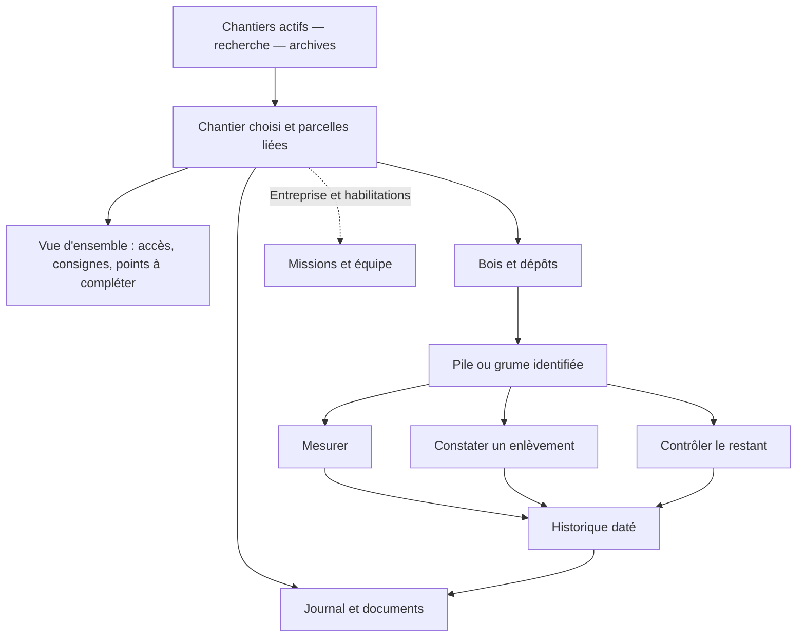

# Métiers du bois : améliorations d'usage et données utiles

Étude du **18 octobre 2026**, pour préparer la démonstration du **mercredi 21 octobre**.
Les propositions ci-dessous enrichissent le cadrage sans annoncer de fonctions déjà
livrées. Les décisions du fondateur priment ; les arbitrages proposés restent identifiés.
Les pages publiques des éditeurs décrivent leurs offres, pas les procédures privées
du client ni une précision de mesure validée indépendamment.

## 1. État réel et objectif

Le code propose actuellement trois profils du parcours bois : exploitant forestier,
conducteur de travaux forestiers et commerce du bois. Les bûcherons, conducteurs
d'abatteuse, débardeurs/câblistes et chauffeurs grumiers n'ont pas encore de profil
spécialisé dans `ProfessionJourneyResolver`. Ne pas les annoncer disponibles.

Les dépôts, objets pile/grume, relevés manuels, corrections et calculs individuels
sont raccordés localement : [bilan vérifié](FORMULAIRES_BOIS_C02_C03_2026-10-18.md).
Les nouveaux objets ne sont pas encore synchronisés. Le formulaire impose aujourd'hui
des unités visibles m/cm ; un choix d'unités supplémentaires exige un raccord réel.
Un brouillon non enregistré ne survit pas encore à une destruction du processus.

L'objectif pratique est de **retrouver son chantier, déclarer ce qui vient de se
passer et remettre des données réutilisables au bureau**, en saisissant chaque
information au bon endroit. Ajouter tous les champs à tous les écrans rendrait
le parcours moins utile.

## 2. Ce que les sources apportent

| Source consultée | Observation vérifiable | Conséquence proposée pour GeoSylva |
| --- | --- | --- |
| S1 — FORLOG | Modules distincts Gestion, Travaux, Suivi, Plateforme, Facturation ; temps, production, entretien/pannes, stocks sur pied/bord de route, bascule et documents. | Le chantier rassemble les informations ; chaque métier utilise quelques actions propres. Mesures, temps, flux et facturation gardent leurs objets distincts. |
| S2 — Timbeter | L'éditeur décrit mesure photographique, données de diamètre, dépôts/essences/motifs de défaut, relevés hors ligne et tableau de gestion. | Lier photo, lieu, défauts et mesure ; retrouver le même bois avant de le remesurer. Le moteur photo reste un lot séparé à évaluer. |
| S3 — Fovea / palos | L'éditeur associe mesures, images et position ; propose saisie individuelle, mesure par sections, exports et fonctionnement hors ligne. La FAQ distingue bois courts photo-optiques et grumes longues saisies numériquement. | Formulaires et protocoles adaptés aux objets ; ne pas promettre une mesure universelle depuis une photo. |
| S4 — Skogforsk / StanForD2010 | Standard de communication des machines forestières, production, suivi et instructions géographiques ; schémas versionnés. | Préparer un futur import de fichiers machine pour réduire la ressaisie, avec version/source/déduplication ; aucune compatibilité déclarée avant recette. |
| S5 — FNB / REGLOBOIS | Présentation d'un parcours chantier, fournisseurs, localisation et démarches réglementaires. | Conserver références, pièces et état des démarches, puis étudier les échanges autorisés ; ne pas recréer immédiatement tout un logiciel réglementaire. |
| S6 — ONF / CNPEF | Préparation, rencontre préalable, intervention, remise en état et réception ; enjeux sols, eau, biodiversité et sécurité. | Ajouter accès, prescriptions localisées et états avant/après ; une fiche créée ne vaut pas autorisation de commencer. |
| S7 — CNPF / Vente de bois | Différence estimation sur pied/cubage des bois abattus, importance des assortiments et qualités, contrat, voies de sortie, dépôts et réception. | Séparer produit commercial, qualité observée, volume, conditions de vente et quantité retenue par contrat. |

**Dernière précision du fondateur le 18 octobre** : FORLOG possède un outil mobile
existant et **GeoSylva le remplacera probablement**. Cette orientation remplace
la réponse initiale « à compléter » ; ce n'est pas encore une décision de bascule
confirmée avec le partenaire. La page publique décrit Android/iOS et le mode
déconnecté ; ni son architecture, ni son API, ni le périmètre exact utilisé par
chaque client ne sont établis ici. GeoSylva conserve son parcours autonome ; son
futur connecteur réutilisera les dossiers/référentiels autorisés au lieu d'imposer
une double saisie. Le remplacement visé concerne l'outil mobile, pas l'ensemble
du logiciel FORLOG de gestion et de facturation.

Pour chaque donnée partagée, le contrat d'échange devra fixer l'outil qui la gère,
les opérations autorisées, les versions et les réponses accepté/rejeté/à corriger.
Proposition : GeoSylva produit les relevés terrain et leurs corrections ; FORLOG
conserve ses circuits de gestion/facturation. L'autorité sur les stocks et les
quantités commerciales reste à confirmer sur des exemples du partenaire.

Pour préparer ce remplacement éventuel, construire une matrice **tâche actuelle →
fonction GeoSylva → données entrantes/sortantes → preuve de fonctionnement**.
Les modules publics donnent des pistes, mais ne suffisent pas à affirmer que toutes
leurs fonctions sont utilisées dans le mobile actuel. À établir avec des exemples
autorisés : consultation des consignes, temps et production, matériel, pièces jointes,
travail sans réseau, corrections, envoi et retour du bureau.

La bascule demandera ensuite un pilote et une reprise des références/données avec
origine, versions, droits et historique conservés. Identifier les saisies en attente
sur l'ancien outil et interdire leur double import ; conserver une possibilité de
retour au fonctionnement précédent. Le scénario de démonstration du 21 octobre ne
vaut pas recette de remplacement ni migration des données du partenaire.

## 3. Adapter les outils au travail réellement réalisé

Les premières lignes concernent les profils déjà présents. Les autres préparent
des profils futurs. L'offre, l'espace et les habilitations contrôlent les données ;
le métier ne donne pas accès aux prix ni aux dossiers d'autrui.

| Utilisateur | Actions mises en avant | Données supplémentaires utiles | À retirer de sa vue courante |
| --- | --- | --- | --- |
| Conducteur de travaux | Préparer le chantier, consulter accès/consignes, relever/contrôler, suivre réalisé et incidents. | Dates prévues/réelles, équipe concernée, activité, raison d'arrêt, état des accès, réserve à lever. | Diagnostics sylvicoles et formulaires de placette pendant le suivi de chantier ; prix confidentiels sans droit. |
| Exploitant / acheteur | Prospecter, estimer, identifier les bois, suivre disponibilité et enlèvements, comparer prévision/réalisé. | Assortiment, qualité et défauts, destination envisagée, coût connu/manquant, conditions du contrat. | Gestion RH ou détail de machine lorsqu'il n'est pas concerné. |
| Commerce du bois | Constituer un lot commercial, consulter qualités/quantités autorisées, préparer l'offre et les documents. | Cahier des charges acheteur, quantités réservées, validité du prix, base HT/TTC du devis. | Missions sans offre Entreprise ; données personnelles des opérateurs et coûts non autorisés. |
| Bûcheron / opérateur d'abattage — futur | Lire consignes, déclarer production/temps, signaler obstacle ou dommage. | Type d'activité, période, quantités avec unité, arrêt/motif ; matériel si pertinent. | Prix de vente, marge de l'entreprise et étapes administratives inutiles. |
| Débardeur / câbliste — futur | Identifier origine/destination, déclarer bois déplacés, signaler accès ou sol dégradé. | Trajet ou secteur réellement utilisé, dépôt destinataire, quantité constatée, contraintes et incident. | Apparition automatique d'une vente ou d'une nouvelle quantité de bois à chaque déplacement. |
| Chauffeur grumier — futur | Retrouver le bon accès, identifier les piles autorisées, déclarer chargement partiel, remettre justificatif. | Passage, lignes par pile, destination, quantité/unité, ticket de pesée à l'arrivée, reste constaté si observé. | Choix de placette, méthodes de martelage ou valorisation propriétaire. |

Missions reste réservé à **Entreprise**, conformément à la décision du fondateur.
Les opérations personnelles autorisées de relevé et de stock ne doivent pas devenir
des missions payantes par simple changement de libellé. Les accès d'équipes ou de
transporteurs externes demandent un véritable partage limité au chantier et à sa durée.

## 4. Interface proposée : un chantier, des actions courtes

Il s'agit d'une **cible**, pas d'une capture du code courant. Éviter une barre
principale remplie de nouvelles destinations. Les actions d'un objet ouvrent un
formulaire court ; le journal conserve le contexte au retour.

Améliorations d'usage à réaliser progressivement :

1. **Reprendre une saisie** : brouillon durable isolé par compte/espace, date de
   dernière sauvegarde, bouton « Reprendre ». Un brouillon reste exclu du stock,
   des totaux et des documents validés. Nettoyage et changement d'identité à traiter.
2. **Enregistrer et ajouter la suivante** : utile pour les grumes. Réutiliser uniquement
   le chantier/dépôt et les paramètres explicitement conservés. Effacer mesures,
   numéro, photo et date du précédent objet ; nouvel identifiant à chaque création.
3. **Retrouver avant de créer** : recherche par plaquette, nom, essence et dépôt.
   Le scan QR/code-barres viendra ensuite. Une même plaquette dans deux organisations
   n'est pas une identité globale. Aucun rapprochement automatique à partir du GPS.
4. **Saisie progressive** : identité et données nécessaires à la tâche d'abord ;
   caractéristiques avancées repliées. Afficher « Enregistré, calcul incomplet » et
   le champ manquant. Ne pas confondre données manquantes et valeurs nulles.
5. **Journal lisible** : une ligne datée par mesure, contrôle, enlèvement ou correction,
   avec nature, auteur autorisé, quantité/unité et justificatif disponible. Les séries
   de mesures ne sont jamais additionnées comme des entrées de stock.
6. **Carte utile** : différencier parcelles d'origine, position du bois, entrée du
   chantier, accès au dépôt et lieu de secours. Afficher source/date/précision du point.
   La route la plus proche n'est pas nécessairement accessible à un grumier.
7. **Photos ciblées** : vue générale, plaquette/défaut, avant/après. Les rattacher
   explicitement à l'objet ou à un événement, conserver l'original et la date connue.
   Une photo ou ses métadonnées ne certifient pas à elles seules la quantité ni la date.
8. **Retour terrain clair** : grandes commandes, clavier adapté, lecture en plein
   jour, possibilité de tout saisir manuellement. La voix reste une aide facultative
   avec relecture ; jamais une validation silencieuse de chiffres reconnus.

Pour les dates, étudier une saisie « date seule / date et heure / inconnue ». Le
contrat actuel attend une date et heure avec fuseau ou une absence : la précision
« date seule » demande une nouvelle version du contrat, sans inventer minuit.

## 5. Données à recueillir, au bon moment

Les champs ci-dessous sont des propositions de modèle. Certains existent déjà
(bruts, méthodes, identité, filiation), d'autres exigent une migration. Un champ
peut rester inconnu lors d'une sauvegarde ; les exigences de validation dépendent
ensuite de l'action et du contrat.

| Objet / événement | Données prioritaires | À quoi elles servent et contrôles |
| --- | --- | --- |
| Chantier | Nom, identifiant, espace, parcelles référencées et versions, contacts utiles, état actif/archivé. | Relier les dossiers sans confondre ONF/cadastre ; conserver l'historique et les accès autorisés. |
| Accès / consigne | Point ou tracé, véhicules concernés, obstacle/restriction connue, source, date, durée éventuelle. | Préparer le déplacement ; information ancienne ou inconnue visible. Aucun guidage poids lourd garanti par un fond de carte. |
| Pile / grume | Identifiant stable, repère/plaquette, dépôt, chantier et origines déclarées, essence, produit/assortiment. | Retrouver le bois ; distinguer objet physique et lot commercial. Provenance géographique ≠ propriété juridique. |
| Observation | Date/précision temporelle, auteur, bruts et unités, instrument/protocole, écorce, méthode, qualité/défauts, photos éventuelles. | Reproduire un calcul, comparer des observations compatibles et expliquer une correction. Qualité déclarée ≠ classement certifié. |
| Passage / enlèvement | Un identifiant d'opération, date, transporteur si connu, destination, plusieurs lignes objet/quantité/unité/convention, état de validation. | Un camion peut charger plusieurs piles ; un envoi rejoué ne crée pas un deuxième mouvement. |
| Contrôle du restant | Date, état entier/partiel/fond de pile/épuisé/inconnu, quantité ou mesures réellement prises, références concernées. | Comparer au restant attendu à cette date ; ne pas fabriquer une sortie pour absorber un écart. |
| Pesée / réception destination | Référence du ticket, brut/tare/net et unités lorsqu'ils existent, lieu/date, opération de transport liée, éventuel déclassement motivé. | Conserver les résultats successifs ; des tonnes à l'arrivée ne remplacent pas des m³ de départ sans règle contractuelle documentée. |
| Activité / matériel | Personne ou équipe autorisée, type d'activité, début/fin ou durée, machine, panne/entretien, unité de production. | Prévu/réalisé, coût et productivité ; distinguer production, trajet, attente et entretien. Pas de paie ou de salaire déduit automatiquement. |
| État des lieux / incident | Localisation, catégorie, observation avant/après, date, photos, responsable de traitement, statut et résolution. | Montrer dégâts préexistants et interventions ; protéger sols/eaux/accès et préparer le contrôle de fin. |
| Base commerciale | Achat/prestation/transport/vente, référence contractuelle, quantité propre, unité, prix et date de validité, traitement fiscal du devis, validation. | Plusieurs usages d'une observation sans écrasement ; pas de facture ou quantité payable issue du seul volume géométrique. |

Conserver pour les données réutilisées : source, version, mode de saisie, auteur
et périmètre d'accès. Une valeur proposée par un pack ou calculée reste distincte
d'une valeur mesurée/confirmée ; le lieu de la parcelle ou du relevé détermine le
contexte régional, pas la position actuelle du téléphone lors d'une consultation.

Le dépôt peut être commun à plusieurs chantiers dans le modèle général, mais les
autorisations de stockage du gestionnaire et le contrat doivent être respectés.
Le CNPEF consulté encadre notamment l'apport d'autres bois sur les places attribuées
(S8, §5.3.6) : ne pas en faire une permission de mélanger toutes les provenances.

## 6. Résultats utiles à calculer ensuite

| Résultat | Conditions nécessaires |
| --- | --- |
| Restant attendu à une date | Base de stock explicitement validée + mouvements validés jusqu'à cette date ; unités/conventions compatibles et corrections appliquées une fois. |
| Écart de contrôle | Restant constaté et attendu au même instant/périmètre et dans la même base ; sinon comparaison indisponible avec motif. Aucun écart transformé automatiquement en perte. |
| Bois disponibles à enlever | Séparer physique, réservation et autorisation d'enlèvement ; une réservation ne sort pas du stock. Un statut « inconnu » reste possible. |
| Qualité des données | Nombre d'objets identifiés/localisés/calculables avec dénominateur et manquants ; pas de score abstrait donnant une fausse impression de précision. |
| Productivité | Quantité comparable / temps de l'activité précisément défini ; pas de mélange m³ apparents/solides ni d'assimilation temps total/temps de production. |
| Coûts et marge prévisionnelle | Quantités, prix et coûts applicables renseignés, base fiscale cohérente, postes manquants signalés ; distinguer estimation, réalisé et facturé. |
| Évolution de la qualité | Observations comparables et dates réelles, défauts documentés ; pas de conclusion sur séchage ou perte de matière depuis une simple variation géométrique de pile. |

La scission/fusion physique des piles et le déplacement entre dépôts demanderont
une filiation explicite. Copier l'objet ou additionner des mesures n'est pas un
mécanisme de transfert. Préparer ce modèle avant une gestion complète des plateformes.

## 7. Ordre recommandé pour l'échéance

Ces priorités sont une recommandation, pas un engagement à tout livrer en trois jours.

| Ordre | Lot | Pourquoi et preuve attendue |
| --- | --- | --- |
| 1 — socle | Chantier → parcelles → bois, archives accessibles. | Respecte la dernière décision du fondateur ; relecture des liens, conservation des anciens objets « à rattacher », permissions et retour de navigation testés. |
| 2 — démonstration | Récapitulatif et exports réels des relevés. | Remettre un fichier exploitable à Forlog ; champs/units/versions et données TEST vérifiables indépendamment. Ne pas sacrifier cet objectif à un nouveau module. |
| 3 — simplicité terrain | « Enregistrer et suivant », recherche, brouillon durable si qualifié. | Réduire ressaisie et perte après interruption ; aucune duplication de mesure, d'identité ou d'espace. |
| 4 — extension sous condition | Enlèvements partiels et contrôles du restant, après validation du modèle de stock. | Démontrer plusieurs passages et un écart sans inventer un mouvement ; ne pas présenter comme fini si la recette n'est pas passée. |
| 5 — après le premier parcours | Photos, accès/consignes, états avant/après ; temps et matériel, profils opérateur/transporteur. | Compléter une tâche réelle à la fois ; captures Android et retour métier avant extension. |
| 6 — intégrations et analyse | FORLOG, fichiers machine StanForD2010, mesure photo, aide IA. | Contrat et exemples réels autorisés, droits, version, déduplication, évaluation terrain et coût maîtrisé. |

Pour mercredi, démontrer un chantier TEST, deux origines parcellaires, un dépôt,
une pile remesurée et des grumes, puis remettre un export constitue une preuve
plus utile qu'une série d'écrans nouveaux sans données persistées. Les mouvements
restent une extension conditionnée à leurs tests, conformément au cadrage précédent.

## 8. Critères de recette à transformer en tests lors du codage

- Saisie en série : après sauvegarde de la grume A, B a un nouvel identifiant et
  aucun diamètre/numéro/photo hérité ; contexte conservé uniquement sur choix visible.
- Brouillon : arrêt de processus puis reprise dans le même espace ; autre compte
  sans accès ; purge sans restauration d'un ancien brouillon ; aucun effet stock.
- Passage : un camion charge A et B ; un double envoi du même passage ne change
  le stock qu'une fois. Une correction conserve opération et lignes d'origine.
- Contrôle rétroactif : constat daté avant le deuxième enlèvement comparé à l'état
  de cette date, pas au solde du jour ; date inconnue exclue d'une comparaison temporelle exacte.
- Unités/conventions incompatibles : afficher deux bases distinctes, pas un total.
- Qualité et prix : changer de profil ne révèle pas un prix non autorisé ; observation
  du transporteur ne valide pas une base achat/vente.
- Photos/GPS : absence d'autorisation, imprécision ou réseau coupé ne détruit pas
  la saisie manuelle ; fichier manquant visible, jamais remplacé par une illustration.
- Archives : chantier retiré des actifs, historique et exports autorisés conservés ;
  aucun stock mis à zéro ni validation commerciale déclenchée par l'archivage.

## Sources et portée de lecture

Consultation publique le **18 octobre 2026**, sauf le PDF S8 téléchargé le 8 puis
relu sur les passages indiqués le 18. Références et empreintes des pièces consultées
dans `RECHERCHE_USAGES_BOIS_SOURCES_2026-10-18.json`. Aucun contenu de ces sites n'est
embarqué dans l'application. Les affirmations commerciales de précision ou conformité
restent celles des éditeurs ; aucune certification GeoSylva n'en est déduite.

- **S1** — [Forêt Logistique Conseil : logiciel FORLOG](https://www.foretlogistique.eu/Gestion-forestiere/forlog/r141.html), descriptions des cinq modules et FAQ.
- **S2** — [Timbeter](https://timbeter.com/), fonctionnement et solutions. Les performances annoncées ne sont pas validées ici.
- **S3** — [Fovea / palos](https://www.palos.eu/fovea/), fonctions et FAQ, notamment limites bois courts/longs. L'ancien domaine Fovea redirige vers cette page.
- **S4** — [Skogforsk : StanForD](https://www.skogforsk.se/english/projects/stanford/), rôle du standard, documents et versions. La présence d'un standard ne prouve pas son support par une machine donnée.
- **S5** — [FNB : REGLOBOIS](https://www.fnbois.com/reglobois/), présentation publiée le 18 juillet 2025 ; pas un audit juridique du service.
- **S6** — [ONF : CNPEF](https://www.onf.fr/produits-services/acheter-du-bois/les-essentiels/+/63f::cahier-national-des-prescriptions-dexploitation-forestiere-cnpef.html), page de publication, édition 2020 et portée en forêt publique.
- **S7** — [CNPF : vente de bois](https://www.cnpf.fr/gestion-durable-des-forets/multifonctionnalite/vente-de-bois), estimation, qualité et clauses de vente. Pas une lecture de la norme AFNOR ni de ses formules.
- **S8** — CNPEF, PDF de l'édition 2020 déjà archivé : lecture ciblée §5.3.6–5.4 (pages imprimées 44–45), dépôts, enlèvement et remise en état ; les prescriptions du contrat applicable restent à vérifier.
