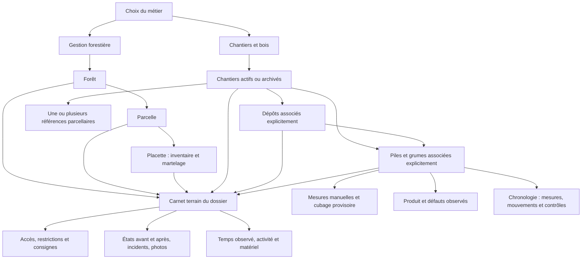
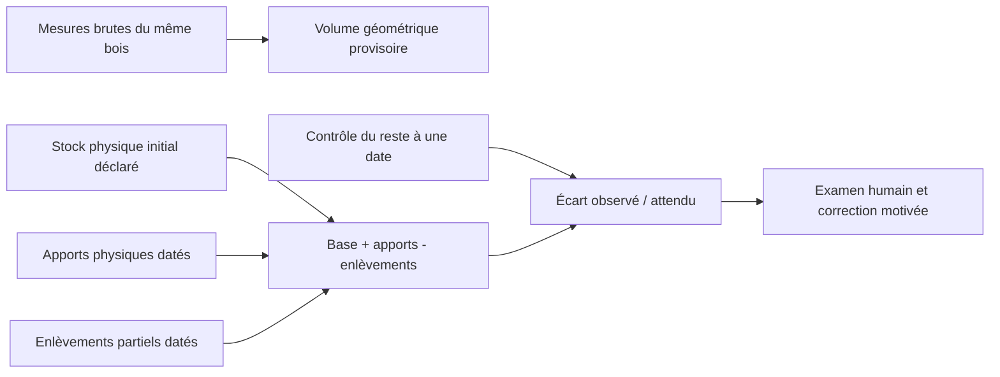

# Carnet terrain commun, chantiers et suivi des bois — 18 octobre 2026

## Décision faisant foi

La demande du 18 octobre étend les améliorations du parcours Bois à la Gestion forestière lorsqu’elles répondent au même besoin terrain. Elle complète les échanges précédents sans transformer une observation sylvicole en mouvement commercial.

GeoSylva vise à terme le remplacement possible de l’outil mobile FORLOG existant. Ce positionnement ne constitue ni un accord de migration du client ni un contrat d’échange validé. L’intégration au logiciel de gestion FORLOG reste ultérieure à la démonstration des parcours locaux.

## Parcours raccordés

Le carnet d’une forêt, d’une parcelle ou d’une placette n’affiche pas les commandes de stock. L’accueil et Explorer du conducteur/exploitant proposent Chantiers et Dépôts. Les Missions demeurent réservées à une offre Entreprise avec habilitations vérifiées : aucun droit n’est déduit du métier choisi.

## Fonctions du lot

| Besoin | Comportement |
|---|---|
| Notes et accès | Titre, constat, date/fuseau explicites, coordonnées manuelles facultatives, véhicule, obstacle et restriction |
| Avant/après et incidents | Événements distincts et photos originales ; pas de diagnostic automatique à partir de la photo |
| Activité | Durée réellement renseignée en minutes, travail, trajet, attente, entretien ou relevé ; matériel facultatif |
| Qualité bois | Produit/usage et défauts déclarés dans le carnet du bois ; aucune classe commerciale déduite automatiquement |
| Brouillons | Champs bruts et opération préparée conservés localement pour le carnet et les formulaires pile/grume ; reprise à l’ouverture du dossier |
| Saisie de grumes en série | Enregistrer puis ouvrir la suivante ; conservation explicite de l’essence, méthode et convention d’écorce seulement ; identité, date et dimensions vidées |
| Retrouver un bois | Recherche dans le dépôt par nom, plaquette ou essence |
| Chantier | Nom, consignes, plusieurs références de parcelles, associations explicites aux dépôts et bois ; archives consultables et réactivation |
| Contrôle du reste | Bois présent, fond de pile, zéro constaté ou non quantifié ; différence avec le solde disponible, sans ajustement automatique |

Un chantier peut être préparé sans référence parcellaire puis complété. Les références ONF/cadastre externes sont déclaratives : elles ne téléchargent pas une couche, ne certifient pas une emprise et ne donnent pas d’autorisation d’accès. Une parcelle déjà enregistrée conserve son identifiant et sa révision locale GeoSylva ; cette révision ne certifie pas la version de publication d’un jeu IGN ou ONF. Le contrat futur distinguera explicitement révision de fiche et édition du référentiel. Les anciennes clés locales non UUID restent acceptées pour forêt/parcelle/placette.

Chaque pile/grume est associée à un seul chantier principal dans cette première version. Un dépôt peut servir plusieurs chantiers ; l’association du dépôt n’attribue pas automatiquement tous ses bois au chantier. Un chantier archivé reste consultable ; les nouvelles observations et modifications de ses bois explicitement associés sont bloquées jusqu’à réactivation.

## Quantités et chronologie

- Un nouveau cubage ne crée jamais de stock. Une date inconnue reste inconnue.
- Une seule base initiale active par bois, unité et convention exacte. Aucun taux de conversion implicite entre bois plein, apparent, stère, tonne et pièce.
- Une sortie exige une base et un solde suffisant. Une correction ne peut pas abandonner les anciens mouvements dans une unité devenue sans base.
- Le calcul historique ignore les mouvements postérieurs au constat. Des mouvements à la même minute sont agrégés : aucune séquence plus précise n’est inventée.
- Un contrôle ne modifie pas le solde. Plusieurs contrôles compatibles au même instant ne sont pas arbitrairement départagés.
- Un reste non quantifié ne vaut pas zéro. Le zéro doit être déclaré avec l’état « aucun bois restant ».
- Les quantités physiques de ce lot ne sont ni une réception contractuelle ni une base payable pour achat, bûcheronnage, débardage, transport ou vente.
- Les corrections conservent l’original et leur motif. La chronologie rassemble mesures de bois et événements du carnet, avec leurs dates de constat et d’enregistrement.

## Sauvegarde et accès

Room 45 ajoute six tables aux tables bois existantes : chantiers, associations, événements, brouillons, photos et fragments de photos. La migration est additive ; aucune ancienne mesure n’est réinterprétée.

Les originaux photo sont copiés dans le stockage SQLCipher existant, avec empreinte SHA-256 et fragments de 128 Kio pour éviter une ligne SQLite dépassant la fenêtre de lecture Android. Limites : six photos par constat, 12 Mio par photo JPEG/PNG/WebP, dimensions contrôlées. La prise de vue utilise un répertoire cache FileProvider limité ; les captures temporaires sont supprimées après import et incluses dans la purge. Aucun envoi de photo n’est effectué.

Les entrées sont personnelles/locales, avec contrôles du propriétaire, de la session, des droits de lecture de la hiérarchie forestière et de l’époque de purge. Un changement de compte invalide le formulaire ouvert. Le bouton de navigation ne constitue pas une autorisation.

L’identité d’une opération est sauvegardée avant son envoi à la base. Un nouvel essai utilise cette identité, pour retrouver le résultat initial sans créer un doublon. Les brouillons sont enregistrés après une courte période de saisie inactive ; l’interface distingue la sauvegarde en cours et confirmée. Une fermeture brutale avant confirmation peut perdre les derniers caractères, pas une observation confirmée.

Les brouillons des formulaires forêt/parcelle historiques ne sont pas remplacés par ce lot. Le formulaire de dossier chantier demande une validation explicite avant de quitter sans enregistrer. Les photos retirées d’un brouillon ne sont plus liées au constat ; leur suppression physique est assurée par la purge complète des données locales.

## Limites et suites

- Aucun connecteur FORLOG, rôle d’entreprise, synchronisation de ce carnet ni réception commerciale n’est simulé.
- L’estimation photographique du volume, les conversions contractuelles, les coûts, recettes et marges restent des lots distincts nécessitant données et méthodes validées.
- Les exports métier existants doivent être étendus explicitement au nouveau carnet avant d’y intégrer photos, événements et mouvements ; ces données ne sont pas annoncées comme déjà exportées vers FORLOG.
- Le changement d’association d’un bois vers un autre chantier et son journal d’affectation complet restent à développer avant l’utilisation multi-entreprises.
- Les réglages de contrôle métier et de réception ne se déduisent pas d’une seule valeur géométrique.

## Vérification

Les résultats de compilation, de tests et les captures Android sont consignés dans le compte rendu de validation livré avec ce lot. Les tests utilisent des bases dédiées TEST ; aucune donnée terrain réelle n’est inventée dans les dossiers utilisateur.
