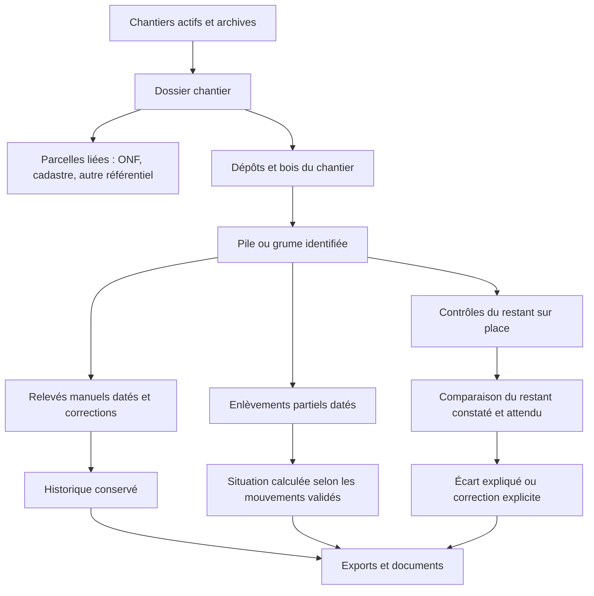

# Chantiers, parcelles et suivi daté des bois

## Décision du fondateur — 18 octobre 2026

Cet échange fait foi sur les documents antérieurs : le parcours bois part du **chantier**,
lié à **une ou plusieurs parcelles**, cadastrales, ONF ou issues d'un autre référentiel
qualifié. Les dépôts, piles et grumes se consultent dans ce contexte. Les enlèvements
partiels et les contrôles successifs se saisissent par date, progressivement.

Cette note décrit la cible. Après C02/C03, le [lot carnet terrain](CARNET_TERRAIN_CHANTIERS_2026-10-18.md)
ajoute les associations chantier/parcelles et le journal physique local. Les circuits
commerciaux, documents et connecteurs complets restent distincts et non livrés.
Les projets historiques ne sont pas transformés automatiquement en chantiers sécurisés.

## Rattachements à réaliser

- Un chantier porte un identifiant durable, un nom, un espace propriétaire, un état
  actif/archivé et une révision. Son archivage le retire des listes actives sans effacer
  ses relevés, réceptions, mouvements ni documents.
- Une association chantier/parcelle conserve l'identifiant local, le **référentiel et
  son identifiant source**, sa version/date lorsqu'elle est disponible. Un numéro ONF
  n'est pas confondu avec une section et un numéro cadastral. Deux polygones superposés
  n'établissent pas automatiquement qu'il s'agit du même objet administratif.
- Un dépôt représente un emplacement physique. Il peut être partagé par plusieurs
  chantiers lorsque les autorisations et contrats le permettent : le **rattachement du bois au chantier** doit rester explicite, sans déduire
  sa provenance du seul GPS du dépôt. Pour la première tranche, un objet de bois a un
  chantier principal ; plusieurs parcelles d'origine peuvent être déclarées, sans
  inventer une répartition de volume entre elles.
- Les dépôts et bois déjà enregistrés restent conservés avec un état « à rattacher »
  lors de cette future migration ; aucun faux chantier ni faux propriétaire n'est créé.
- La sélection de parcelles sur carte ne donne aucun droit sur les données d'un autre
  compte ou organisme. Les associations et lectures suivent l'espace actif autorisé.
- Les chantiers personnels restent utilisables sans Missions. La page Missions demeure
  réservée à l'offre Entreprise avec appartenance et capacités vérifiées.

## Trois actions différentes sur le même bois

| Action | Informations à enregistrer | Effet |
| --- | --- | --- |
| Relever/remesurer | Objet, date constatée et fuseau, dimensions brutes et unités, protocole, essence/qualité, observations, auteur et date d'enregistrement | Ajoute une observation. Ne crée pas une nouvelle entrée de stock. |
| Constater un enlèvement | Objet(s), date effective, quantité et unité/convention, transporteur ou véhicule lorsqu'ils sont connus, destination si connue, justificatif/référence, auteur | Crée un mouvement seulement après validation explicite. Un passage peut prendre une partie de plusieurs piles ; le bordereau et ses lignes restent liés. |
| Contrôler le restant | Date, pile entière/fond de pile/épuisée/inconnu, quantité ou dimensions réellement relevées, méthode, observations/photos disponibles | Ajoute un constat. Ne transforme pas automatiquement la différence en enlèvement, perte ou correction. |

Un fond de pile n'est pas « zéro » et l'absence de mesure n'est jamais zéro.
« Pile épuisée » est un constat explicite ; l'objet et son historique restent consultables.
Une observation d'enveloppe rectangulaire de hauteur nulle ne sert pas à contourner
le protocole en fabriquant un volume : le futur constat d'épuisement a son propre type.

Chaque action accepte un brouillon incomplet, mais les champs requis pour **valider
un mouvement** sont indiqués. La sauvegarde d'un brouillon ne change pas le stock.
Date d'événement et date d'enregistrement restent distinctes, notamment hors ligne.
Les modifications après validation créent une correction justifiée et traçable.
Une date ancienne saisie tardivement n'écrase pas le dernier état par simple ordre d'arrivée.

## Exemple de recette synthétique, non commercial

1. Une pile TEST est identifiée au dépôt d'un chantier lié à deux parcelles.
2. Une réception valide une base initiale de 30 unités **dans une convention identique**.
3. Premier passage : enlèvement validé de 12 → restant attendu 18.
4. Second passage : enlèvement validé de 10 → restant attendu 8.
5. Contrôle terrain : restant constaté 7 → écart de −1 à expliquer ; aucun troisième
   enlèvement n'est inventé. Un contrôle ultérieur ou une correction peut documenter l'écart.

Les nombres sont des données TEST. L'application doit exiger l'unité et la convention
réelles : tonnes, m³ de bois plein, m³ apparents ou stères ne s'additionnent pas librement.
Une remesure géométrique et une quantité contractuelle peuvent différer. Toute conversion
exige une règle applicable, documentée et versionnée ; aucun coefficient régional arbitraire.

## Suite de réalisation

1. C02/C03 vérifié : formulaires manuels, sauvegarde durable, historique, correction
   et calcul géométrique provisoire. Voir les [preuves et limites](FORMULAIRES_BOIS_C02_C03_2026-10-18.md).
2. Créer le dossier chantier et ses associations autorisées aux parcelles/dépôts/bois,
   puis sa navigation spécifique et son archivage. Préserver les dossiers antérieurs.
3. Raccorder réception/bases initiales et journal daté des mouvements, contrôles du
   restant, fonds de pile et écarts, avec confirmations adaptées et fonctionnement hors ligne.
4. Exporter ces événements avec leurs identifiants, versions et états ; définir ensuite
   le contrat réel d'acceptation/rejet FORLOG, sans en déduire les procédures WinDev manquantes.

Le connecteur FORLOG, la synchronisation des nouveaux objets, les quantités payables,
les photos et le cubage par image ne sont pas fournis par le formulaire local actuel.

La [recherche métier du 18](AMELIORATIONS_USAGES_METIERS_BOIS_2026-10-18.md) complète
les données de passage, les accès et les améliorations de saisie. Le fondateur a
confirmé que FORLOG possède déjà un outil mobile, que GeoSylva pourrait remplacer.
