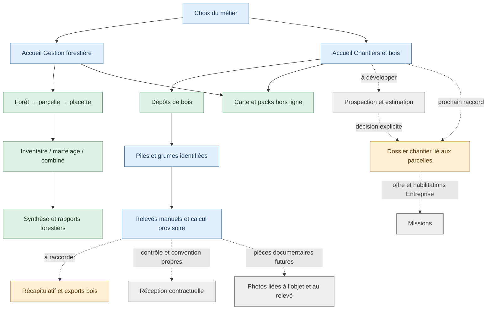
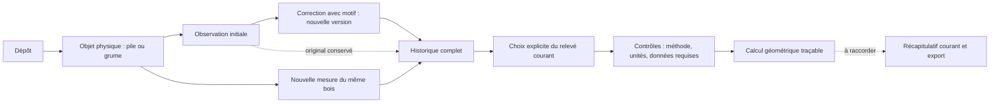
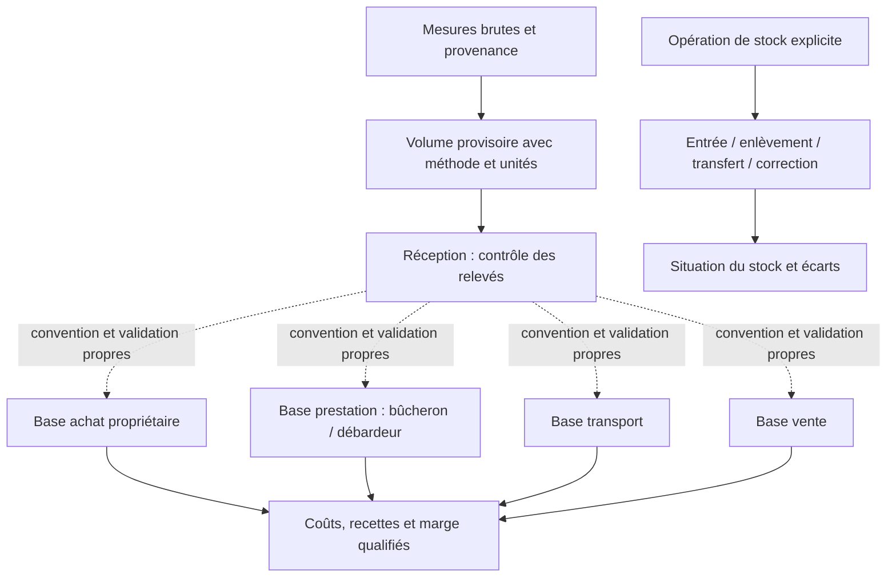
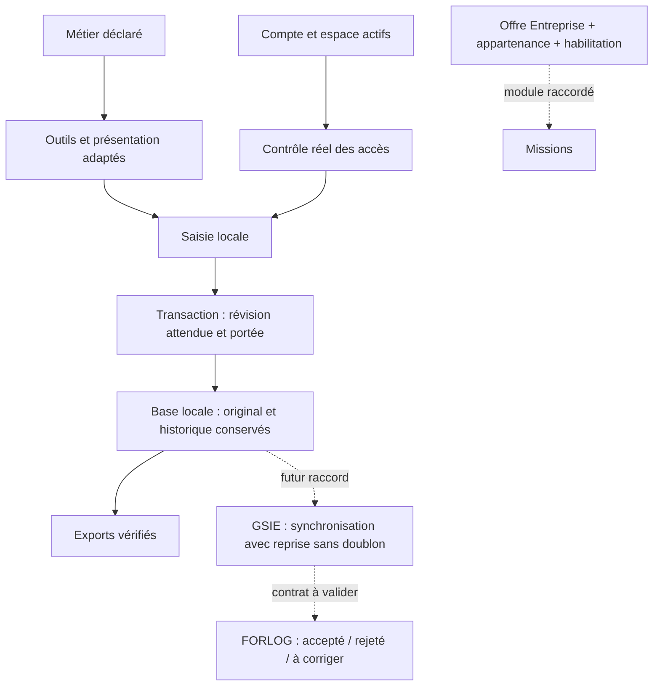

# Parcours GeoSylva — point du dimanche 18 octobre 2026

Objectif : démonstration le **mercredi 21 octobre**. Les trois journées de préparation sont dimanche 18, lundi 19 et mardi 20. L’ordre ci-dessous préserve la séparation des données et la qualification de chaque fonction ; il ne promet pas que toutes les extensions seront terminées à cette date.

Les décisions récentes du fondateur priment. La restauration du 15 est conservée, avec ses preuves de compilation et de tests. Les schémas représentent la cible discutée ; leur légende distingue le code raccordé du travail restant.

## Complément : chantier et passages successifs

Le [schéma chantier/parcelles/suivi daté](CHANTIERS_PARCELLES_SUIVI_DATE_BOIS_2026-10-18.md)
formalise la précision du fondateur. La cible utilise le chantier comme entrée,
avec plusieurs parcelles possibles, et conserve les contrôles et enlèvements
partiels successifs. L’accès direct aux dépôts reste la tranche locale actuellement
raccordée. Les [formulaires C02/C03](FORMULAIRES_BOIS_C02_C03_2026-10-18.md) sont
vérifiés sur Android ; réception commerciale, mouvements et exports bois ne sont pas
inclus dans ce seul lot.

## 1. Deux parcours d’entrée

Vert : parcours déjà présent dans la base restaurée. Bleu : navigation et formulaires du 18 octobre, composants vérifiés sur Android. Orange : raccord à développer avant de le présenter comme disponible. Gris : extension ultérieure. Voir la [validation de navigation](VALIDATION_PARCOURS_2026-10-18.md) et celle des [formulaires](FORMULAIRES_BOIS_C02_C03_2026-10-18.md) pour la portée exacte des essais, qui ne constituent pas encore une recette complète du parcours bois.

La carte existante permet la consultation de couches. Le guidage forestier spécialisé reste à réaliser. Le dépôt existe avec création, édition, position optionnelle et archivage ; la consultation/restauration des archives reste à compléter. Les objets bois, relevés, corrections et choix du relevé de référence sont désormais persistés et utilisables dans les formulaires. Ce parcours calcule une géométrie provisoire ; il ne constitue pas une réception contractuelle.

Le [complément du 18 octobre](PROSPECTION_ESTIMATION_PHOTOS_BOIS_2026-10-18.md) ajoute
la prospection, l’estimation et les photos documentaires. L’éventuel calcul depuis
des photos sera évalué séparément ; aucune fonction photographique n’est annoncée disponible.

## 2. Une seule identité pour le bois, plusieurs relevés conservés

**Règles** : une correction conserve l’original ; la sélection courante n’est pas remplacée silencieusement. Une observation corrigée est signalée et exclue du récapitulatif tant qu’une tête valide n’est pas choisie. Absence, zéro et valeur invalide restent distincts. Les volumes apparents de piles ne sont pas additionnés aux volumes solides des grumes.

## 3. Mesure, stock et transaction commerciale restent distincts

Il n’y a volontairement **aucune flèche automatique du relevé vers une entrée de stock**. Une remesure ne crée pas du bois supplémentaire. Une quantité géométrique n’est pas payable par défaut. Les prix, taxes, conventions et validations commerciales doivent être connus ; le choix HT/TTC est explicite par devis.

## 4. Accès, sauvegarde et future synchronisation

Le métier ne donne pas de droits entreprise. Une affiliation déclarée à l’ONF n’est pas une autorisation d’accès. Missions reste invisible tant que son module et les preuves nécessaires ne sont pas disponibles. L’archivage conserve l’historique ; la suppression de compte reste une autre procédure.

## Ordre de réalisation

| Journée | Travail prioritaire | Preuve attendue |
| --- | --- | --- |
| **Dimanche 18** | Réalisé : navigation métier, accueil, Explorer ; objets bois et relevés manuels persistés, corrections, sélection et calcul individuel | Captures Android, 1 776 tests JVM et 36 tests Android distincts réussis ; périmètre local décrit dans la validation |
| **Lundi 19** | Chantier lié aux parcelles et bois, navigation et archives ; récapitulatif puis préparation des enlèvements datés | Rattachements explicites, données antérieures conservées, aucun droit déduit de la carte ; distinguer constat du restant et mouvement |
| **Mardi 20** | Récapitulatif, exports réels et recette ; mouvements uniquement si le modèle est qualifié | Fichiers réouverts et vérifiés, données TEST identifiées, APK installable |
| **Mercredi 21** | Démontrer le parcours effectivement qualifié | Version figée et limites connues ; aucune fausse synchronisation FORLOG |

Le périmètre minimal est **dépôt → pile/grume → mesures conservées → calcul explicable → export**. Les mouvements, coûts, recettes et marges suivent leurs critères de validation. Les systèmes d’IA et le connecteur FORLOG ne doivent pas retarder ou simuler ce premier parcours. Le serveur de comptes et sa configuration Google restent une qualification distincte.

Références : [plan UX](PARCOURS_UX_DEMO_21_OCTOBRE_2026.md), [BOIS-01](SPEC_BOIS_01_PRET_A_CODER_2026-10-14.md), [lots C01–C07](PLAN_CODAGE_BOIS_2026-10-14.md).
