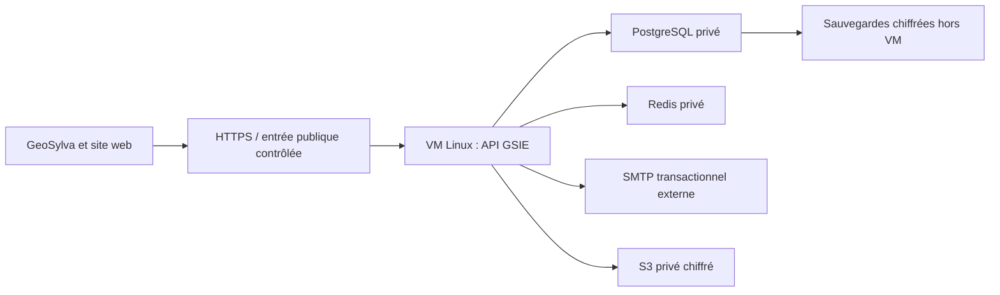

# Hébergement pilote des premiers comptes GSIE

**Préparation du 15 octobre 2026 — aucune prise de contact, commande, création de ressource ou modification de production.** Les prix ci-dessous proviennent de lectures publiques officielles effectuées ce jour. La disponibilité réelle d'une offre et le panier final restent à vérifier avant souscription.

## Proposition

Demander à **Datacampus** un devis pour une VM Linux **4 vCPU, 8 Go de RAM, 80–100 Go de SSD**, avec une variante **6–8 vCPU, 12–16 Go de RAM** et les services d'exploitation détaillés séparément. En parallèle, garder **OVHcloud VPS-2/VPS-3 en France** comme référence de coût pour une VM administrée par nos soins. L'offre Datacampus peut être plus intéressante si elle inclut une véritable assistance d'exploitation ; comparer seulement le nombre de vCPU masquerait cette différence.

Ce dimensionnement est un **point de départ pour un pilote limité**, pas une capacité démontrée ni une promesse de nombre d'utilisateurs. Mesurer démarrage, inscription, connexion, renouvellement, révocation et consommation sous charge sur le serveur retenu. **Aucun GPU n'est nécessaire pour ouvrir les premiers comptes.** L'inférence IA, la génération des packs et les simulations territoriales formeront des charges séparées ultérieurement.

## Ce que le code exige réellement

Lecture de `GSIE/API/README.md`, `pyproject.toml`, `Dockerfile`, `Dockerfile.db`, `docker-compose.yml`, `gunicorn.conf.py`, `core/config.py` et `docs/BACKUP_RESTORE.md` du checkout disponible. Ce document ne certifie pas que toutes ces configurations ont déjà été déployées.

| Composant | Besoin constaté et implication |
| --- | --- |
| API | FastAPI/Python 3.12, Gunicorn/Uvicorn, JWT RS256, Argon2id, code d'identité et renouvellement de session. L'image embarque déjà des dépendances scientifiques et un module Rust ; ce n'est pas une petite image d'authentification isolée. |
| PostgreSQL | PostgreSQL 16 avec PostGIS, Apache AGE, pgvector, pgAudit et pg_stat_statements dans l'image actuelle. Une offre PostgreSQL managée standard peut ne pas autoriser AGE : demander explicitement ces extensions ou conserver PostgreSQL dans la VM. Ne pas remplacer la base par SQLite pour le pilote public. |
| Redis | Nécessaire pour le stockage distribué des refresh tokens et de la limitation, ainsi que nonce Google et événements suivant activation. Les stockages `memory://` sont refusés en staging/production. Redis reste privé, authentifié, sans port public. |
| Courriels | SMTP externe réel, chiffré par STARTTLS ou TLS direct : inscription/vérification et récupération. Mailpit est réservé au développement et ne délivre pas les messages aux utilisateurs. Cloudflare DNS/Tunnel ne remplace pas un prestataire d'envoi. |
| Stockage objet | La validation actuelle impose S3 et chiffrement côté serveur en staging/production, même si l'objectif immédiat concerne les comptes. Un bucket compatible doit donc être fourni, ou l'architecture explicitement modifiée et testée avant de prétendre s'en passer. MinIO local dans le Compose est un environnement de développement. |
| Tâches et surveillance | Worker outbox si les événements sont utilisés, contrôle de disponibilité externe, alertes disque/mémoire/échecs d'envoi, rotation des journaux. Ne pas activer de téléchargement massif ni de traitement climatique lors du lancement des comptes. |
| Entrée HTTPS | Le dépôt prévoit Cloudflare Tunnel optionnel avec jeton en fichier secret. Une autre terminaison HTTPS correctement configurée est possible, mais ce serait un choix de déploiement à qualifier. L'API, PostgreSQL, Redis et les consoles ne deviennent pas tous publics. |

Le Compose limite actuellement l'API à **2 Go**, PostgreSQL à **1 Go**, Redis à **512 Mo**, MinIO de développement à **1 Go**, et l'outbox à **256 Mo**, avant OS, caches et autres services. Ce sont des plafonds de configuration, pas des mesures de charge. Un commentaire du benchmark historique signale environ **726 Mio au repos pour cinq workers API** : cela justifie une marge, pas une extrapolation de capacité.

Le réglage par défaut est **cinq workers Gunicorn**. Pour un petit pilote, tester deux workers peut réduire la mémoire, mais il faut également adapter les pools PostgreSQL et transmettre explicitement le paramètre au conteneur ; un simple changement de fichier `.env` non injecté n'a pas d'effet.

La page vitrine existante peut rester sur son hébergement actuel. Il n'est pas nécessaire de migrer le site web vers cette VM pour mettre l'API en ligne.

## Comparatif public qualifié

Prix en euros **HT**, hors prestations non explicitement incluses. Le TTC indiqué pour OVH applique la TVA française de 20 %, avec arrondi ; il ne préjuge pas du régime fiscal de l'entreprise ni de son droit à récupération de TVA.

| Fournisseur / offre | Ressources affichées | Mensuel sans engagement relevé | Prix avec paiement anticipé | Ce que cela couvre / limites |
| --- | --- | --- | --- | --- |
| **Datacampus** | À demander : 4 vCPU / 8 Go / 80–100 Go SSD ; variante supérieure | **Sur devis, non vérifié** | À demander | Demander localisation primaire/secours, ressources garanties ou partagées, exploitation, sauvegardes, support et réversibilité. Les deux URLs publiques testées renvoient HTTP 403 depuis cet environnement ; aucun tarif ou certificat n'est affirmé. |
| **OVHcloud VPS-2, gamme nommée « 2027 » par le catalogue** | 4 vCores, 8 Go RAM, 75 Go NVMe, 1 Gbit/s annoncé | **8,49 € HT/mois**, soit environ **10,19 € TTC** | **7,21 € HT/mois équivalent**, engagement et paiement d'avance de 12 mois, soit **86,52 € HT** pour 12 mois | Linux et stockage local à 0 € dans le catalogue sélectionné. IPv4 et anti-DDoS annoncés inclus. Sauvegarde Standard annoncée incluse ; détails ci-dessous. Administration applicative et SMTP non inclus. |
| **OVHcloud VPS-3, gamme « 2027 »** | 6 vCores, 12 Go RAM, 100 Go NVMe, 2 Gbit/s annoncé | **12,24 € HT/mois**, soit environ **14,69 € TTC** | **10,40 € HT/mois équivalent**, 12 mois d'avance, soit **124,80 € HT** | Même distinction entre VM, administration, sauvegarde PostgreSQL et services externes. Plus de marge pour l'image actuelle ; pas de haute disponibilité avec une seule VM. |
| **Scaleway DEV1-L** | 4 vCPU, 8 Go RAM, 400 Mbit/s annoncés | **0,04284 € HT/h**, soit environ **31,27 € HT pour 730 h** | Réduction Savings Plans annoncée séparément, non utilisée ici | **Stockage local/bloc et IPv4 publique exclus** du prix affiché ; IPv6 et egress annoncés inclus. Plus flexible pour construire ensuite une architecture de services séparés, mais le prix de VM seul n'est pas comparable à une enveloppe tout compris. Disponibilité de cette ancienne gamme à vérifier. |

Les prix OVH « à partir de » ne correspondent **pas** au paiement mensuel sans engagement. Le catalogue officiel `order/catalog/public/vps?ovhSubsidiary=FR` expose les modes `default`, `upfront6` et `upfront12`. Pour les deux offres retenues, les frais d'installation Linux/VM affichés sont nuls. Les contrats et le panier doivent confirmer les conditions de fin d'engagement : le catalogue indique `REACTIVATE_ENGAGEMENT` pour le mode payé d'avance. Aucun engagement annuel n'est conseillé avant la recette du pilote.

### Sauvegardes : ne pas confondre les protections

- OVH présente le Standard comme une sauvegarde quotidienne des **dernières 24 heures** ; le Premium annonce sept jours. La page contient aussi une note générale évoquant sept jours : retenir la garantie de l'option effectivement commandée, pas la note la plus favorable.
- Le catalogue chiffre le Standard VPS-2 à 0,50 € HT/mois avant une **remise de 100 %** actuellement répertoriée (total 0 €). La promotion n'indique pas de date de fin ; sa condition `minimumDuration: 2` n'est pas explicitée dans l'extrait. Confirmer son application au panier et au renouvellement, plutôt que promettre une gratuité contractuelle illimitée.
- La page OVH indique une réplication dans le **même datacenter** et l'exclusion des disques additionnels pour la sauvegarde décrite. Cela ne remplace pas une copie PostgreSQL restaurable dans un autre lieu.
- Le dépôt GSIE possède pgBackRest chiffré, mais son `repo2` S3 distant est **encore commenté** dans le modèle lu. Le volume `repo1` local seul ne protège pas de la perte de la VM ou du site.
- Objectif pilote à valider : sauvegarde externe quotidienne au minimum et test de restauration complet avant comptes réels. Les cibles documentaires RPO 5 min / RTO 15 min exigent WAL/PITR, surveillance et exercice chronométré ; elles ne sont pas acquises par achat d'un VPS.

## Coût réel à demander et suivre

`Coût mensuel = VM + stockage objet + sauvegardes externes + SMTP + supervision/support + trafic/options éventuels`.

| Poste | À chiffrer avant ouverture |
| --- | --- |
| VM | Montant mensuel, engagement, installation, CPU partagé/dédié, stockage et redimensionnement. |
| Données applicatives S3 | Go stockés, requêtes et sorties réseau ; chiffrement, localisation, versionnement et politique de rétention. Ne pas stocker une collection nationale de cartes pour ouvrir quelques comptes. |
| Sauvegarde indépendante | Go retenus + stockage des WAL + transfert ; clés conservées séparément ; opération de restauration comprise ou facturée. |
| SMTP | Volume de vérifications/récupérations, quotas, domaine d'envoi, SPF/DKIM/DMARC, gestion des rejets. Le service et le domaine déjà disponibles restent à confirmer. |
| Exploitation | Qui corrige OS/Docker/PostgreSQL, reçoit les alertes et restaure en incident ; horaires et délais de support. L'absence de frais d'infogérance signifie que ce travail nous revient. |
| Environnements | Staging isolé et comptes TEST séparés ; coûts éventuels d'une seconde petite VM. Un namespace seul n'offre pas la même séparation qu'un hôte distinct. |

Aucun total « tout compris » n'est inventé tant que les lignes S3, sauvegarde, SMTP et support ne sont pas choisies. Pour le pilote, comparer **OVH mensuel** et **devis Datacampus** sur ce même périmètre. Scaleway sert de référence européenne additionnelle, pas de choix imposé.

## Limites d'une seule VM et étapes avant premiers comptes

Une VM unique est raisonnable pour une démonstration et un pilote limité, avec reprise organisée. Une panne de l'hôte, une maintenance ou une saturation affecte ensemble API et base : **ce n'est pas de la haute disponibilité**. Le SLA commercial de la VM ne constitue pas le SLA de GSIE.

1. Qualifier la base de code retenue et ses migrations sur un environnement staging distinct ; configurer explicitement `GSIE_ENVIRONMENT`, rôle/namespace, accès SQL applicatif sans bypass RLS, TLS PostgreSQL et secrets réels.
2. Construire les images en CI ou sur une machine de build ; déployer des images identifiées. Ne pas lancer simultanément compilation scientifique et comptes réels sur une VM contrainte.
3. Raccorder SMTP, S3 chiffré, sauvegarde distante et entrée HTTPS ; garder les consoles d'administration privées, avec MFA pour les comptes opérateurs.
4. Tester inscription et vérification du courriel, récupération, expiration/renouvellement, révocation, séparation des comptes et refus d'accès entre espaces. Google vient ensuite avec les vrais clients OAuth/empreintes Android et son nonce distribué ; l'achat d'un VPS ne configure pas Google.
5. Vérifier l'effacement de compte et les chemins RLS avec le rôle de production, sans supposer qu'un test sous propriétaire PostgreSQL prouve l'isolement.
6. Faire un redémarrage, une restauration hors VM et un test de charge représentatif ; mesurer mémoire, latence, connexions DB et disque. Définir alors les limites du pilote et les alertes.

Séparer plus tard base, stockage et workers quand les mesures ou la disponibilité l'exigeront. Les traitements GPU, LLM et simulateurs du Hub ne doivent pas monopoliser le serveur des comptes.

## Brouillon de relance Datacampus — non envoyé

**Destinataire fourni par l'utilisateur :** Pierre Pluviaud — pierre@datacampus.fr. Identité et adresse non vérifiées indépendamment par les pages publiques inaccessibles.

**Objet : Reprise de notre échange — hébergement pilote Quintessences / GeoSylva**

Bonjour Monsieur Pluviaud,

Je reviens vers vous au sujet de l'hébergement de Quintessences et de son application forestière GeoSylva. Nous préparons les premiers comptes utilisateurs et les essais terrain. Notre priorité immédiate est un service d'identité et de synchronisation fiable ; les traitements d'IA et de simulation viendront progressivement dans un second temps.

Pourriez-vous nous proposer un chiffrage pour une VM Linux de 4 vCPU, 8 Go de RAM et environ 80 à 100 Go de stockage SSD, ainsi qu'une variante de 12 à 16 Go de RAM ? Notre application utilise Docker Compose, une API Python/FastAPI, PostgreSQL 16 avec PostGIS, Apache AGE, pgvector et pgAudit, ainsi que Redis. Nous avons également besoin d'un stockage objet compatible S3 chiffré et de sauvegardes PostgreSQL restaurables hors de la VM. Le relais SMTP transactionnel peut être fourni séparément.

Pour comparer correctement les propositions, pourriez-vous préciser :

- la localisation effective des données et des sauvegardes, notamment les possibilités autour de Niort ou du Futuroscope ;
- les ressources incluses, le trafic, les possibilités d'augmentation et les interruptions nécessaires ;
- le prix HT mensuel, les frais de mise en service, l'engagement éventuel et le tarif de renouvellement ;
- les sauvegardes incluses, leur rétention et la procédure de restauration, avec une copie dans un autre site ;
- ce qui relève de notre administration et ce que vous pouvez prendre en charge : maintenance, surveillance, support et intervention ;
- les conditions de réversibilité et le délai de mise à disposition d'un environnement de test.

Une démonstration de GeoSylva est prévue le mercredi 21 octobre. Nous souhaitons surtout préparer une base d'hébergement saine et évolutive ; l'ouverture de comptes réels suivra la validation technique.

Seriez-vous disponible pour un échange court afin de confirmer ce périmètre et de préparer votre proposition ?

Bien cordialement,
Quintessences / GeoSylva
https://quintessences-platform.com

## Sources et traçabilité

Lectures publiques du **15 octobre 2026**, TLS vérifié. Les réponses originales et SHA-256 se trouvent dans `/workspace/.onboarding/hosting-2026-10-15/HTTP_SOURCES.json` et les fichiers voisins ; aucun compte fournisseur n'a été ouvert.

- Datacampus : <https://www.datacampus.fr/> et <https://datacampus.fr/> — **403**, pas de contenu tarifaire exploité. Le devis reste indispensable.
- OVHcloud, présentation VPS : <https://www.ovhcloud.com/fr/vps/> — **200** ; ressources, prix de vitrine, inclusions et limites de sauvegarde.
- OVHcloud, catalogue public français : <https://eu.api.ovh.com/v1/order/catalog/public/vps?ovhSubsidiary=FR> — **200** ; plans `vps-2027-model2` et `vps-2027-model3`, modes et engagements, TVA, options et promotions. Extraction ciblée dans `/workspace/.onboarding/hosting-2026-10-15/OVH_SELECTION_QUALIFIEE.json`.
- Scaleway, tarifs des instances : <https://www.scaleway.com/en/pricing/virtual-instances/> — **200**, tarifs HT, exclusions stockage/IPv4 et prix horaires. L'ancienne URL française a redirigé vers le catalogue général ; la page anglaise dédiée a été lue.
- Code local : `/workspace/Quintessences/GSIE/API/`, notamment `src/gsie_api/core/config.py:417`, `docker-compose.yml`, `Dockerfile.db`, `docker/pgbackrest.conf`, `gunicorn.conf.py` et `docs/BACKUP_RESTORE.md`.

**Inconnus à lever :** offre Datacampus et support réel ; utilisateurs simultanés/volumes du pilote ; SMTP existant ; bucket S3 compatible ; politique de sauvegarde et exercice de reprise ; accès DNS/Tunnel et configuration OAuth réelle ; disponibilité régionale et panier de souscription. Les chiffres de performance ou promesses marketing des hébergeurs ne sont pas assimilés à des résultats mesurés de GSIE.
