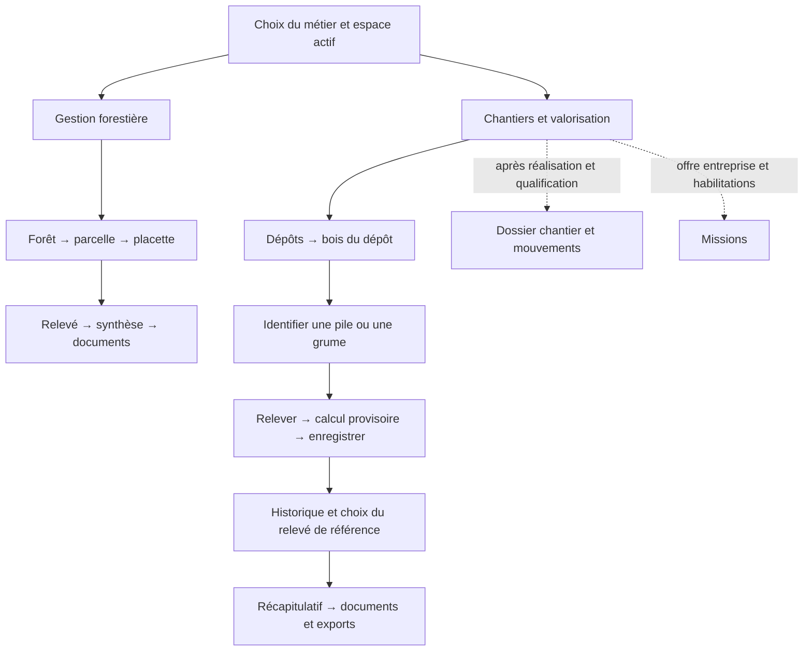

# GeoSylva — parcours et améliorations UX pour la démonstration du 21 octobre 2026

**Point courant du 18 octobre** : navigation métier et formulaires bois sont désormais
raccordés ; lire leur [bilan vérifié](FORMULAIRES_BOIS_C02_C03_2026-10-18.md).
La [recherche d'améliorations métier](AMELIORATIONS_USAGES_METIERS_BOIS_2026-10-18.md)
complète ce cadrage avec des sources publiques, les données utiles, la saisie en série
et les futurs profils opérateur/transporteur. Un premier [lot de mise en œuvre](CARNET_TERRAIN_CHANTIERS_2026-10-18.md) est ajouté le 18 :
carnet partagé, chantiers, brouillons, saisie en série et suivi physique. Les profils
futurs, contrats commerciaux et connecteurs restent à construire. Le tableau daté
du 15 ci-dessous décrit l’état avant ces travaux.

**Cadrage du 15 octobre 2026.** Ce document distingue le code présent dans l'application restaurée et les écrans à réaliser. Il ne constitue ni une recette Android ni une preuve de fonctionnement des parcours futurs. Les décisions récentes de l'utilisateur et la [spécification BOIS-01](SPEC_BOIS_01_PRET_A_CODER_2026-10-14.md) prévalent sur les anciennes présentations universelles de l'application.

## Résultat à rendre démontrable

Le conducteur de travaux doit retrouver un dépôt, identifier une pile ou une grume, relever ses mesures, corriger une erreur sans perdre l'original et remettre un fichier lisible. L'exploitant doit comprendre quels bois ont réellement été mesurés et quelles observations composent le récapitulatif. Le parcours commercial réutilisera ensuite ces mesures avec ses conventions d'achat, de prestation, de transport et de vente propres.

Le technicien conserve son parcours **Forêt → Parcelle → Placette → Inventaire/martelage → Synthèse**. Le parcours **Chantiers et valorisation du bois** dispose de ses objets et de ses commandes ; une placette ne devient pas une pile par changement de libellé. Un dépôt peut être créé indépendamment d'un chantier, en attendant le raccord du dossier chantier.

Les pointillés représentent des raccords à construire, pas des accès disponibles. Le terme utilisateur « relevé de référence » désigne ici l'observation explicitement choisie pour le récapitulatif courant ; il ne vaut pas validation technique ou commerciale.

## État observé dans le code restauré

| Élément | Présent dans le code | Limite constatée au 15 octobre |
| --- | --- | --- |
| Métiers | Choix de métier, symboles, code `conducteur_travaux_forestiers`, profils exploitant et commerce ; résolveur de parcours pur. | Les deux expériences ne sont pas encore complètement raccordées à l'accueil et à Explorer. Le choix de métier n'accorde aucun droit. |
| Accueil | Accès Explorer, création et forêts récentes dans `HomeScreen`. | Contenu encore forestier pour les métiers chantier. Aucun accueil opérationnel complet n'est démontré par ce code. |
| Explorer | Entrée dépôts adaptée aux trois profils bois. | Conducteur/exploitant voient encore Forêts, Parcelles, Placettes, Essences et Diagnostics ; commerce conserve des entrées forestières. Une animation de rafraîchissement est simulée sans rechargement métier dédié. |
| Missions | Destination présente dans la navigation ; politique d'accès pure distinguant offre, contexte, adhésion et capacités. | `MainScaffold` parcourt encore toutes les destinations et rend `ComingSoonScreen` pour Missions. La politique doit être raccordée avant de prétendre respecter l'exclusivité entreprise dans l'interface. |
| Dépôts | Écran Compose, liste, création, édition, détail, confirmation d'archivage ; repository Room avec portée locale/personnelle, contrôle de révision et changement d'identité. | Position manuelle optionnelle ; pas de sélection cartographique dédiée dans cet écran. L'API actuelle expose les dépôts actifs, pas une consultation/restauration des archives. |
| Piles, grumes, mesures | Noyaux purs de saisie numérique, calcul géométrique et historique avec sélection explicite. | Aucune interface ni persistance complète de ces objets n'est prouvée par ces seuls noyaux. Les champs du contrat BOIS-01 doivent tous être raccordés, notamment la longueur des pièces distincte de la profondeur d'une pile. |
| Documents | Parcours de rapports de synthèse forestière restauré. | Il ne constitue pas un export de réception de bois. Le snapshot et les formats BOIS-01 ont leur propre modèle. |
| Collaboration | Exigences et politique d'accès documentées. | Le premier dépôt local/personnel n'est pas un espace entreprise partagé. Le connecteur FORLOG et ses accusés d'acceptation ne sont pas branchés. |

Sources lues : `presentation/screens/home/HomeScreen.kt`, `presentation/screens/explorer/ExplorerScreen.kt`, `presentation/screens/wood/WoodDepotsScreen.kt`, `presentation/navigation/MainScaffold.kt`, `presentation/navigation/ForestryFlowNavGraph.kt`, `domain/journey/`, `domain/wood/` et `data/repository/WoodDepotRepositoryImpl.kt`. Le checkout évolue pendant la restauration ; recontrôler les fichiers avant chaque lot.

## Priorités écran par écran

**P0** : nécessaire au premier parcours réception réellement utilisable. **P1** : extension après qualification de ses dépendances, à viser pour la démonstration si elle est validée. **P2** : étape suivante explicitement présentée comme telle. Ces priorités ordonnent le travail ; elles ne déclarent pas les extensions réalisées.

| Écran / priorité | Amélioration concrète | Critère visible de réussite |
| --- | --- | --- |
| **1. Choix du métier — P0** | Conserver les symboles demandés. Distinguer technicien, conducteur de travaux, exploitant et commerce ; courte description des tâches. Conserver les codes enregistrés et traiter les anciennes valeurs sans réaffectation silencieuse. | Choisir conducteur conduit au parcours bois. Revenir au métier technicien retrouve ses dossiers, sans migration ou duplication des données. |
| **2. Accueil métier — P0** | Pour le conducteur : accès principal « Relever du bois », dépôts récents, reprises de saisie réellement disponibles. Pour le technicien : conserver les accès forêt et relevé. Ne pas afficher des indicateurs à zéro quand leur calcul n'existe pas. | Un utilisateur du parcours bois atteint un dépôt sans traverser Forêt/Parcelle/Placette. Aucun bouton inactif présenté comme opérationnel. |
| **3. Explorer — P0** | Brancher la politique de parcours sur une liste unique d'outils effectivement disponibles. Mettre Dépôts et relevés au premier plan pour les métiers bois ; retirer leurs entrées de diagnostic forestier non pertinentes. Remplacer le faux rafraîchissement par une vraie lecture ou supprimer le geste. | Même destination et même retour depuis Accueil/Explorer. Pas de carte « stock », « chantier » ou « marge » ouvrant une coquille vide. |
| **4. Navigation et Missions — P0** | Filtrer barre principale et menu alternatif avec la même décision d'accès. Missions n'apparaît que pour l'offre entreprise, dans l'espace autorisé, avec les habilitations applicables et le module réellement disponible. | Offre individuelle, absence de preuve serveur, expiration ou mauvais espace ne donnent pas accès à Missions. Changer de métier ne débloque pas l'offre. |
| **5. Liste des dépôts — P0** | Conserver la base existante ; cartes sobres nom/type/localisation et un bouton principal « Ajouter un dépôt ». Ajouter recherche/filtre seulement sur données disponibles. Préparer un accès Archives distinct après raccord du repository. | Liste vide utile, chargement et erreur explicites ; absence de position ne devient ni erreur bloquante ni coordonnées fictives. |
| **6. Créer/modifier un dépôt — P0** | Garder nom, type, notes et localisation optionnelle ; sections secondaires repliables. Ajouter carte/GPS en P1 avec permission ponctuelle et précision affichée. En attendant, décrire honnêtement la saisie de coordonnées. | Clavier ouvert et texte à 200 % : champs, erreurs et validation restent accessibles. Quitter un brouillon demande un choix. Édition concurrente ne remplace pas silencieusement la version. |
| **7. Fiche dépôt — P0** | Ajouter la liste « Bois de ce dépôt », puis « Ajouter une pile » et « Ajouter une grume ». Afficher contexte, position et état local ; déplacer modification/archivage dans les actions secondaires. | Une fiche reste compréhensible sans carte. Identité du dépôt et objet sélectionné restent visibles pendant le relevé. |
| **8. Identifier le bois — P0** | Formulaire court : pile ou grume, repère humain/plaquette, essence et autres métadonnées connues. Distinguer identité stable et observation. Informations avancées progressives : produit, qualité, provenance, localisation propre. | Deux relevés du même objet conservent son identifiant. Un numéro de plaquette n'est pas supposé unique dans toutes les entreprises. Sauvegarde possible avant d'avoir toutes les mesures. |
| **9. Relevé de pile — P0** | Montrer longueur de pile, profondeur et hauteur moyenne, avec unités et protocole. Longueur des pièces séparée. Petit schéma technique coté uniquement s'il clarifie ces axes. Chaque absence/valeur invalide est signalée près du champ. | Le résultat porte la nature « volume apparent » et les hypothèses. Aucune conversion implicite en volume solide ou quantité payable. La mesure brute reste retrouvable. |
| **10. Relevé de grume — P0** | Présenter longueur, diamètre médian et, suivant la méthode, diamètres aux extrémités. Méthode visible Huber/Smalian/Newton ; unités et position de mesure explicites. Écorce renseignée ou signalée inconnue. | Changer de méthode ne supprime pas les mesures saisies. Un champ manquant affiche la raison du calcul indisponible ; zéro, absence et erreur ne sont pas confondus. |
| **11. Enregistrement du relevé — P0** | Récapitulatif compact avant sauvegarde. Choix visible « Utiliser pour le récapitulatif courant », précoché uniquement si aucune sélection n'existe. Confirmation locale, puis accès au bois suivant. | « Enregistré sur cet appareil » ne prétend pas une synchronisation GSIE. Un calcul géométrique reste provisoire sans convention commerciale. |
| **12. Fiche bois et historique — P0** | Montrer séparément le relevé courant choisi et les observations datées. Actions distinctes « Nouveau relevé », « Corriger ce relevé », « Utiliser ce relevé ». Motif de correction obligatoire. | Corriger conserve l'original, crée une nouvelle révision et ne sélectionne pas automatiquement celle-ci. Une référence corrigée est signalée et exclue jusqu'au choix explicite d'une tête valide. |
| **13. Récapitulatif du dépôt — P0** | Tableau des objets, résultat choisi, méthode, unités et couverture ; groupes de résultats compatibles. Actions pour compléter ou sélectionner les relevés exclus. Présenter date de situation et périmètre. | Une pile remesurée n'est pas additionnée deux fois. Un total absent n'est pas affiché comme zéro. Les volumes apparents/solides et conventions incompatibles ne sont pas mélangés. |
| **14. Documents et exports — P0** | Choisir « Situation courante » ou « Historique des observations ». CSV, GeoJSON et PDF adaptés aux destinataires ; aperçu des contenus et limites. Reprendre la qualité du sélecteur de rapports forestiers, avec le modèle bois. | Fichiers issus du repository réel, réouverts et vérifiés après remise Android. L'historique n'a pas de total des remesures ; les objets sans GPS sont conservés avec géométrie absente. |
| **15. Archives — P1, prioritaire après le parcours P0** | Ajouter consultation/filtre des dépôts et objets archivés, puis restauration selon le contrat de données. Historique et documents restent consultables. Définir séparément l'archivage des futurs chantiers. | Archiver retire de la liste active sans signifier « bois enlevé » ou « stock nul ». Restaurer ne redémarre pas une mission et ne crée aucun mouvement. |
| **16. Dossier chantier — P1** | Objet dédié : localisation, contrat, prescriptions, accès/dépôts, consignes/sécurité, documents et lien prévu/réalisé. Chemin adapté au conducteur. Lien dépôt/chantier explicite, sans détour forcé par une forêt. | Le type de contrat détermine documents et formalités applicables. Les données connues restent traçables ; aucun permis de commencer n'est déduit d'une simple fiche créée. |
| **17. Inventaire et mouvements — P1** | Écrans séparant constat d'inventaire, enlèvement, transfert, livraison et correction. Quantité, unité, origine/destination, date, auteur et justification appropriés. Confirmation de l'effet avant enregistrement. | Remesurer ne crée pas une entrée de stock. Un fond de pile et un stock constaté nul sont saisissables explicitement. Les écarts sont expliqués et les nouvelles commandes ne doublonnent pas les mouvements. |
| **18. Valorisation commerciale — P1/P2 selon contrats** | Vues achat, prestation, transport et vente avec leurs bases propres. Coûts, recettes et marge uniquement à partir de données renseignées et conventions qualifiées. Choix HT/TTC explicite par devis. | Une seule observation peut alimenter plusieurs quantités commerciales identifiées. Prix absent = information manquante ; aucun prix régional inventé, aucune facture issue du seul volume géométrique. |
| **19. Missions — P2 sauf raccord entreprise qualifié avant la démo** | Dossier commun, calendrier, affectation équipe sans référent obligatoire, remise par membre habilité avec participants. Contrôle configurable par modèle tracé ; réception contractuelle distincte. | Offre, espace, membre et capacités réelles contrôlés. Une tâche simple peut être clôturée directement ; un travail à contrôler suit son circuit. Pas de simulation de droits pour rendre l'onglet visible. |

Les écrans 8 à 14 correspondent à la suite de six vues BOIS-01, réparties ici par tâche utilisateur pour préparer la maquette. Il n'est pas nécessaire de créer dix nouvelles destinations : formulaire progressif, panneau de détail et dialogues peuvent partager le même modèle d'état.

## Trois usages, un modèle cohérent

| Profil | Ordre d'information conseillé | Ce qui ne doit pas être imposé |
| --- | --- | --- |
| Conducteur de travaux | Chantier quand disponible, accès et sécurité, dépôts, relevés, réalisé, écarts, équipe selon offre. | Entrée obligatoire par forêt ou diagnostic écologique pour réceptionner une pile. |
| Exploitant forestier | Bois identifiés, réception, situation du dépôt, inventaires/enlèvements, valorisation qualifiée. | Recréation d'un objet à chaque passage ou conversion automatique d'un volume apparent. |
| Commerce du bois | Qualité/essence/produit, quantité et convention, documents, bases d'achat/vente et coûts autorisés. | Accès implicite à Missions ou exposition de prix confidentiels parce que le métier est choisi. |

La carte, les réglages du compte et les packs restent des services transversaux. Pour un dossier existant, données et paramètres régionaux sont déterminés par le lieu du bois, de la parcelle ou du relevé ; la position actuelle du téléphone ne change pas les tarifs d'un dossier éloigné. Le choix d'espace et les autorisations déterminent les données accessibles.

## Présentation et interaction

- Employer les composants Material 3 et les tokens existants : surfaces lisibles, un appel principal par écran, actions dangereuses secondaires. Conserver les symboles de métiers ; pas de nouveau décor ou de bibliothèque uniquement pour animer un formulaire.
- Réserver les schémas au placement réel des mesures, les tableaux aux comparaisons et la carte à la localisation. Les graphiques proviennent de résultats calculés, avec unités et couverture ; ne pas réintroduire l'ancien « Tableau de bord » supprimé.
- Sur le terrain, garder des cibles d'au moins 48 dp, des contrastes suffisants, des libellés visibles et des commandes utilisables sans geste précis. Le retour haptique suit les préférences ; aucune promesse de filtrer la pluie par logiciel ou de mesurer une pente sans source adéquate.
- Prévoir clavier numérique adapté, virgule décimale, unité toujours visible, validation près du champ, conservation des bruts et retour arrière sûr. Les erreurs de précision ou de protocole ne sont pas cachées dans une notification éphémère.
- Utiliser une courte transition entre étapes et une confirmation de sauvegarde discrète. Respecter les réglages de réduction d'animations ; éviter les animations permanentes derrière la saisie.
- Externaliser les textes en ressources FR/EN. Qualifier petite largeur, paysage, clavier ouvert, police 200 %, lecteur d'écran et mode sombre. Un bouton désactivé doit expliquer la donnée manquante.
- Distinguer brouillon, enregistré localement, attente d'envoi et accepté par le serveur uniquement lorsque ces états existent. Une connectivité réseau ne prouve pas l'acceptation d'un relevé.

## Ordre de réalisation jusqu'au mercredi 21 octobre

1. **Restaurer et qualifier le socle**, puis raccorder N01/N02 : politique de navigation, deux accueils, Explorer et masquage effectif de Missions. Vérifier les deux métiers sur Android avant d'étendre les écrans.
2. **Compléter C01/C02** : contrat complet des bruts, identités/observations/sélection, Room, commandes et garde d'accès. Les noyaux purs déjà présents aident ce travail ; ils ne remplacent pas les transactions, migrations et règles de purge.
3. **Raccorder C03/C04** : dépôt → objet → relevé → historique → récapitulatif, calculs réels, situations incomplètes et conflit de correction. Montrer les écrans visuellement importants dans le simulateur et intégrer les retours utilisateur.
4. **Réaliser C05/C06/C07** : snapshot, CSV/GeoJSON, PDF et remise Android vérifiée. Les fichiers doivent survivre aux nouvelles observations sans réécriture de l'ancien rapport.
5. **Étendre les archives, le chantier et les mouvements selon dépendances qualifiées**. Valider chaque effet métier avant d'ajouter coûts, recettes et marge. Si un raccord n'est pas fini, le retirer du chemin démontré et annoncer son état ; ne pas le remplacer par un faux service.
6. **Préparer le jeu TEST et l'APK**, parcourir gestion forestière et réception sur une installation réelle. Le fichier d'installation doit être fourni par un lien téléchargeable testé ; tracer version et empreinte de l'APK.

Le délai n'autorise pas à fusionner mesures, stock et paiement dans une même opération. Le connecteur FORLOG vient après les exports réels et le contrat d'échange confirmé. Google, SMTP et GSIE requièrent leurs configurations réelles ; la démonstration hors ligne ne dépend pas d'une fausse connexion.

## Recette de démonstration à préparer

Le jeu de données est **synthétique et explicitement marqué TEST** dans l'application et les documents, conformément à la décision de l'utilisateur. Il utilise les mêmes repositories, calculs et contrôles que le parcours réel ; il n'accorde aucun droit entreprise. Aucune mesure synthétique n'est attribuée à un client ou à un véritable agent.

| Scénario | Preuve attendue |
| --- | --- |
| Technicien | Ouvrir une forêt/parcelle/placette, réaliser un relevé et retrouver sa synthèse/document. Pas de retour de l'ancien écran Tableau de bord. |
| Conducteur hors ligne | Créer un dépôt, une pile et une grume ; mesures persistées après fermeture/réouverture ; valeurs et unités retrouvées exactement. |
| Pile remesurée | Ajouter un second relevé au même objet ; le nombre de piles reste un et le récapitulatif utilise au plus la sélection choisie. |
| Correction et désaccord | Conserver la source, exiger un motif, signaler la référence corrigée ; choisir explicitement la nouvelle tête. Refuser une écriture sur une révision dépassée sans perdre la saisie. |
| Données incomplètes | Enregistrer un objet sans position et un relevé incomplet ; afficher ce qui manque, sans volume ou coordonnées inventés. |
| Documents | Ouvrir CSV, GeoJSON et PDF réellement produits ; vérifier identité/version/unités/TEST, couverture et géométrie absente. Un fichier écrit non relisible reste « non vérifié ». |
| Archives, si raccordées | Retirer de l'actif puis retrouver l'historique ; aucun mouvement ou stock nul induit. |
| Isolement et navigation | Changer de compte/espace, vérifier la disparition des anciennes données et le refus des commandes périmées ; Missions invisible hors conditions réelles. |
| Ergonomie | Captures portrait/paysage, clavier et texte 200 %, navigation retour, permissions GPS refusées, interruption/reprise d'app ; pas de texte masqué ni perte silencieuse. |

Références de réalisation : [SPEC BOIS-01](SPEC_BOIS_01_PRET_A_CODER_2026-10-14.md), [plan C01–C07 et recette R01–R17](PLAN_CODAGE_BOIS_2026-10-14.md), [priorités du 21 octobre](PRIORITES_DEMONSTRATION_21_OCTOBRE_2026.md). Les annexes historiques partiellement récupérées doivent rester signalées comme telles ; une reconstitution ne devient pas une preuve d'ancien code exécuté.
