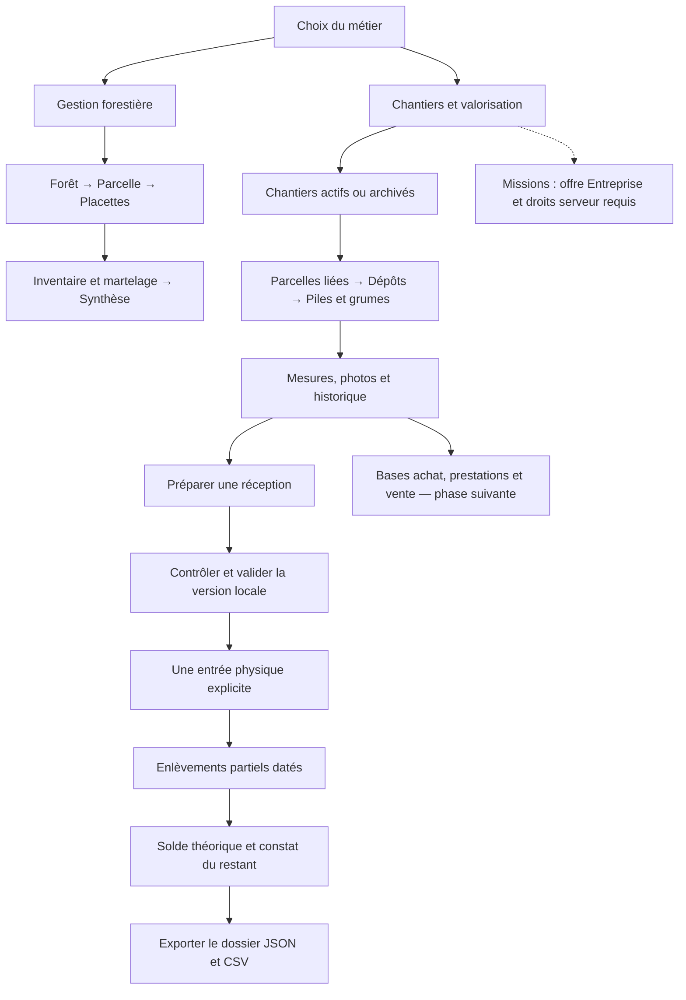

# Prochain lot — réception locale, stock et exports

Date : 19 octobre 2026. Statut : plan technique préparé, pas fonctionnalité livrée.
Objectif : démonstration autonome du mercredi 21 octobre, sur données TEST explicites.
Base : [qualification du dossier FORLOG](QUALIFICATION_FORLOG_2026-10-19.md),
consignes du fondateur et socle GeoSylva Room 45.

## Parcours proposé

Les professionnels de terrain continuent à travailler dans leur espace personnel
hors ligne. Une profession adapte la navigation ; elle n'accorde pas des droits
sur un chantier d'entreprise. Les diagnostics et outils forestiers restent dans
le parcours de gestion. Le carnet commun reste accessible aux deux parcours.

## 1. Réutilisation du socle

Conserver `WoodObjectRepository`, `FieldRepository`, les identifiants actuels,
les photos chiffrées, les brouillons et `HarvestedWoodCalculator`.
Ne pas créer un second objet pile pour une réception ou une remesure.
Ne pas créer un second moteur de solde concurrent de `FieldBalance`.

Les modifications devront être additives, avec migration testée depuis Room 45
si de nouvelles tables sont nécessaires. Les données anciennes restent lisibles.
Une base locale initiale sans réception conserve son statut de déclaration historique.

## 2. Tranche R1 — document de réception et validation

Objets à ajouter : brouillon/document de réception, lignes et validation de version.
Ils portent un identifiant stable, le périmètre propriétaire, un chantier, un dépôt,
les objets bois existants, la version des observations retenues, une date de fait
avec son fuseau, la date d'enregistrement, l'auteur et les justificatifs.

Une ligne distingue : mesure géométrique source, quantité physique déclarée,
unité, convention/version et explication éventuelle d'un écart. Le volume calculé
peut aider la saisie ; il n'est pas converti silencieusement en volume payable.
Une donnée inconnue reste inconnue. Enregistrer un brouillon n'affecte aucun solde.

Circuit local : brouillon → à contrôler → validé localement. La personne qui
contrôle peut être l'auteur, conformément au choix déjà exprimé par le fondateur.
Ce contrôle personnel n'est ni une signature contractuelle d'entreprise, ni un
accusé GSIE/FORLOG. Aucun validateur fictif n'est attribué à une saisie anonyme.

La validation fige les lignes et références, puis crée une seule entrée physique
par ligne dans une transaction avec l'accusé technique de commande. Une contrainte
d'unicité lie réception/version/ligne et entrée. Rejouer la même commande rend son
résultat initial ; même ID avec contenu différent échoue sans effet.

Le garde d'accès est revérifié dans la transaction et au retour. Une réponse
perdue après validation conduit à rechercher/rejouer le même ID, pas à créer une
nouvelle réception. Les brouillons restent isolés par espace et cible.

**Données antérieures :** si une pile a déjà un stock initial, bloquer un second
crédit de la même réception supposée. Proposer une qualification explicite ultérieure
de la déclaration existante ; ne pas la certifier par migration. Le scénario TEST
de réception nouvelle commence sur un objet sans stock initial.

## 3. Tranche R2 — sorties, constats et corrections

Réutiliser les formulaires du carnet : date effective, quantité, unité/convention,
transporteur ou référence connus, destination déclarée et justificatif. Distinguer
« bois enlevé », « livré » et « accepté par le destinataire ».

Le solde de l'objet reste homogène par unité et convention. Une remesure ou un
constat du restant ne crée pas de débit ni de crédit. Fond de pile, zéro constaté
et inconnu restent trois états différents. Les sorties successives ne peuvent
pas rendre le solde négatif à une date intermédiaire.

Une correction déjà validée garde sa version d'origine et son motif. Avant
d'annuler une réception utilisée par des sorties, énumérer les dépendances et
refuser une suppression automatique. La compensation doit préserver les soldes
intermédiaires. Les achats, ventes et paiements ne sont pas annulés par assimilation.

La concurrence entre deux écritures locales utilise la transaction et la révision
attendue. La concurrence entre appareils attend la future autorité serveur ; ne
pas qualifier le solde local de stock global garanti.

## 4. Tranche R3 — export vérifiable

Créer un instantané cohérent du périmètre autorisé : chantier, liens parcellaires,
dépôts, objets bois, observations et corrections, réception/version/validation,
événements physiques, photos référencées et soldes par convention.

Le manifeste porte version de format, ID d'export, date UTC, périmètre, identifiants
et versions inclus, fichiers et SHA-256. Préserver les nombres décimaux exacts,
unités, conventions, dates de fait et d'enregistrement. Pour le CSV : UTF-8,
séparateur documenté, valeurs inconnues distinctes de zéro et protection contre
l'interprétation des notes comme formules de tableur. Le JSON conserve le texte brut.

Lire les fichiers produits dans un vérificateur indépendant pour reconstruire les
soldes. Contrôler l'accès avant capture et au partage, ainsi que les changements
de session. Les photos ne sont jointes que par sélection explicite et autorisée.
Utiliser le partage Android/Storage Access Framework, sans chemin client arbitraire.

Afficher « Export GeoSylva ». Exporté, accepté par GSIE et accepté par FORLOG sont
trois états distincts. Ne pas ajouter un faux indicateur de synchronisation.

## 5. Tranche R4 — présentation et recette mobile

Le dossier chantier propose des entrées claires : Bois et dépôts, Réceptions,
Mouvements et contrôles, Documents. Les nouvelles entrées ne deviennent cliquables
que lorsque leur parcours est raccordé. Éviter de multiplier les formulaires :
sélectionner les bois existants puis proposer un récapitulatif modifiable.

Afficher les différences utiles : mesure source, quantité retenue localement,
reste attendu, dernier constat et écart. Les actions principales sont Enregistrer
le brouillon, Contrôler, Valider localement, Constater un enlèvement et Exporter.
Une validation doit montrer ses effets avant confirmation.

Respecter les textes FR/EN, clavier, grandes polices, cibles tactiles et retour
après fermeture. Vérifier les changements visuels importants sur simulateur Android,
puis fournir un APK TEST distinct de la production pour validation sur téléphone.
Les données de démonstration sont explicitement synthétiques et ne contaminent
ni l'espace utilisateur normal ni un référentiel partagé.

## 6. Recette minimale à implémenter et exécuter

| ID | Scénario | Résultat attendu |
| --- | --- | --- |
| R01 | Chantier avec deux parcelles et une pile, fermeture complète puis reprise | Identifiants et liens conservés |
| R02 | Brouillon contenant 100 unités homogènes de TEST | Aucun mouvement avant validation |
| R03 | Validation puis rejeu identique | Une seule entrée de 100 |
| R04 | Nouvelle observation du même bois à 98 | Stock 100 ; écart déclaré, aucune entrée automatique |
| R05 | Sorties successives de 25 puis 75 | Soldes 75 puis 0 ; dates et auteurs conservés |
| R06 | Rejeu, même ID modifié, sortie supplémentaire de 1 | Aucun double débit ; modification et dépassement refusés |
| R07 | Deux sorties concurrentes incompatibles | Une seule acceptée au maximum dans le périmètre transactionnel testé |
| R08 | Tonnes, volume apparent ou convention différente | Aucun total mélangé ni conversion implicite |
| R09 | Annulation de la réception après enlèvement | Dépendances visibles ; pas de suppression ni solde négatif caché |
| R10 | Export JSON/CSV puis relecture | Mêmes identifiants, versions et soldes ; accents et notes de type formule traités |
| R11 | Archivage puis consultation | Retrait de la liste active, historique conservé ; écriture ordinaire bloquée |
| R12 | Changement de compte et accès direct non autorisé | Aucune lecture/écriture/export de l'autre espace |
| R13 | Gestion forestière, application sans offre Entreprise | Aucun crédit commercial depuis martelage ; Missions indisponible |
| R14 | Migration d'un ancien stock initial | Données préservées, pas de réception inventée ni second crédit |

Ces cas définissent la recette future. Les fixtures reçues ne prouvent pas que
ces parcours ont été exécutés sur Android ou sur un serveur.

## 7. Après le démonstrateur

Ajouter des bases commerciales séparées pour propriétaire, travaux, débardage,
transport et acheteur : bénéficiaire, quantité, convention, prix, HT/TTC, TVA
explicitement renseignée, justification et version validée. Un prix ou coût
manquant empêche une marge présentée comme exhaustive ; il ne vaut pas zéro.

Les transferts multi-dépôts, le transit et la filiation des portions de pile
demandent une opération atomique et leur propre recette. Une destination ne
doit pas réutiliser indistinctement une identité de pile physique scindée.
Les possibilités de photos ne constituent pas un cubage photographique qualifié.

Pour les échanges, préparer un adaptateur dédié et des vecteurs communs avec GSIE.
Conserver l'outbox et les accusés atomiquement avec les opérations ; autoriser un
lot partiellement accepté de façon explicite. Un SHA-256 vérifie le contenu,
pas l'identité ni l'autorisation de l'émetteur. Le branchement FORLOG attend le
contrat réellement autorisé et les exports WinDev manquants.

L'échéance du 21 octobre guide les priorités ; elle n'autorise pas à annoncer
comme livré un circuit commercial, serveur ou connecteur encore non testé.
