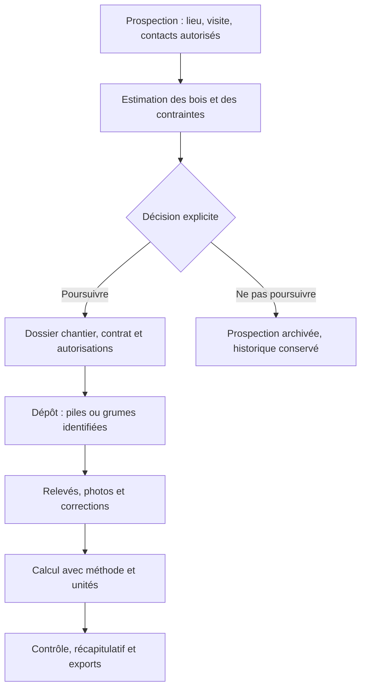

# Prospection, estimation et photos des bois

Décision du fondateur du 18 octobre : ajouter la prospection de chantier, l’estimation des bois, des photos des piles et la conservation des relevés. Étudier ensuite une estimation de volume assistée par l’image. Continuer dans l’ordre du socle, sans annoncer ces pages comme déjà disponibles. Ce complément prime sur les anciens cadrages qui les omettent.

## Parcours à construire

Une prospection n’est ni un contrat signé, ni une autorisation de travaux, ni un stock acquis. L’estimation sur pied reste distincte de la mesure après exploitation. On lie les dossiers d’origine sans transférer automatiquement les volumes. Le parcours concerne d’abord conducteur de travaux, exploitation et commerce du bois ; la gestion forestière conserve ses propres estimations et relevés.

La fiche de prospection devra permettre : nom et lieu, origine de l’opportunité, contact saisi légitimement, visite prévue/réalisée, observations et photos, essences/qualités déclarées, méthode et couverture de l’estimation, accès et contraintes, documents, décision et motif d’archivage. Les informations inconnues restent absentes. Les relances simples d’un dossier ne donnent pas accès au module Missions, réservé à l’Entreprise.

## Photos à conserver avec les données

- Identité stable de la pile/grume ; plusieurs photos possibles, rattachées explicitement à l’objet et, si elles documentent une mesure, à l’observation exacte.
- Photo terrain ou import clairement distingués. Date de prise et position déclarées/métadonnées restent distinctes de la date d’ajout et de la position mesurée dans l’application. L’EXIF ne constitue pas une preuve vérifiée.
- Copie durable dans le stockage privé de l’application : ne pas conserver uniquement une URI temporaire de caméra/galerie. Original et vignette séparés, orientation respectée, type/taille/décodage contrôlés, empreinte pour détecter une altération ou un doublon de fichier.
- Enregistrement interrompu, espace insuffisant et reprise explicites : un fichier manquant ne doit pas apparaître comme sauvegardé. Association objet/relevé et fichiers promus sous le même contrôle d’accès/purge ; nettoyage des fichiers temporaires orphelins.
- Archivage conserve les pièces autorisées ; suppression explicite et effacement de compte traitent les fichiers également. Exports et future synchronisation annoncent si les photos sont incluses, absentes ou en attente. Aucun usage d’entraînement ni téléversement vers une IA par défaut.

## Cubage photographique : progression proposée

1. **D’abord** : photos documentaires + dimensions saisies et méthode explicite. Le calcul réel utilise les dimensions, pas une appréciation visuelle inventée.
2. **Puis** : aide à mesurer une face de pile avec une référence d’échelle connue, détection/contour corrigeable et contrôle de la perspective. La profondeur et les longueurs de pièces doivent être renseignées ou mesurées séparément. Le volume apparent inclut les vides ; il n’est pas un volume de bois solide.
3. **Après évaluation** : plusieurs vues, reconstruction 3D ou capteur de profondeur compatible. Conserver images sources, calibration, paramètres, version du modèle, corrections humaines et nature du volume estimé. Une confiance annoncée par un modèle ne remplace pas une erreur mesurée sur des piles de référence.

Une photo isolée sans échelle et sans information de profondeur ne détermine pas un volume unique. Pas de conversion automatique apparent/solide, pas de précision universelle annoncée, pas de quantité payable issue d’une simple photo. Les coefficients et conventions éventuels doivent avoir leur source, domaine d’application et validation commerciale propre.

Avant de choisir une bibliothèque ou un fournisseur : comparaison de solutions réelles, compatibilité commerciale des licences et des modèles, fonctionnement hors ligne, appareils supportés, coût, confidentialité, export des résultats et mesure de l’erreur par type de pile. Cette note est un cadrage de réalisation ; elle ne prétend pas qu’un tel benchmark a déjà été exécuté.

## Ordre et critères de sortie

Le minimum démontrable reste dépôt → objet physique → observations persistées → calcul explicable → exports vérifiés. C01/C02 précèdent les pages C03. Les photos documentaires seront une extension de ce parcours après validation de la sauvegarde des observations ; leur ajout au format persistant devra être versionné. La prospection se branche ensuite sur le dossier chantier, sans imposer une forêt/parcelle fictive. L’estimation photographique reste un chantier expérimental séparé.

Recette future : retrouver les photos après fermeture/redémarrage ; aucune association à un autre objet/compte ; interruption sans faux succès ; remesure sans doublon de bois ; correction avec origine conservée ; export relu avec pièces/empreintes ; photo non exploitable conservée comme document sans volume calculé.
