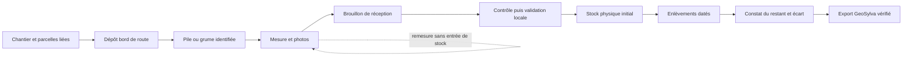

# Réceptions et stocks — essai sur téléphone

Version TEST du 19 octobre 2026, démonstration visée le 21 octobre.
Les données ci-dessous sont **simulées**. Elles ne représentent ni une réception
commerciale, ni un chantier client. L'application ne doit pas les présenter comme
des observations réelles ou les envoyer à FORLOG.

## Parcours à montrer

## Installation

L'APK porte le nom **GeoSylva TEST Réceptions** et l'identifiant
`com.forestry.counter.preview.receptions`. Il s'installe à côté de GeoSylva et de
l'ancienne application TEST. Ne désinstaller aucune version existante pour cet
essai : leurs bases locales sont indépendantes.

L'APK est une compilation de test signée avec la clé de développement, pas une
version de production. Il contient les nouvelles fonctions locales. Les services
GSIE, Google et FORLOG ne sont pas configurés dans cette variante ; aucune
connexion ou synchronisation opérationnelle n'est promise.

Au premier lancement, sélectionner **Conducteur de travaux forestiers**, puis
**Continuer** et **Continuer hors ligne** sur la page de connexion. Ouvrir ensuite
**Explorer → Chantiers**. Les données du scénario sont à saisir ; elles ne sont
pas préchargées dans l'APK.

## Exemple cohérent de bout en bout

1. Choisir le parcours chantier/conducteur de travaux. Créer **TEST · Chantier
   des Deux-Sèvres**, avec des références parcellaires explicitement TEST.
2. Créer **TEST · Dépôt du chemin nord**, puis **TEST · Pile de chêne 01**.
   Saisir une enveloppe de 10 m × 5 m × 2 m. Le résultat géométrique attendu est
   **100 m³ apparents** ; ce n'est pas automatiquement un volume de bois plein
   ou une quantité payable. Ajouter une photo d'essai, si souhaité.
3. Rattacher ce bois au chantier. Depuis le dossier chantier, ouvrir
   **Réceptions**, créer une réception et sélectionner cette observation.
4. Saisir **100 m³ apparents**, avec la convention **TEST enveloppe rectangulaire**,
   version **1**, et une date/fuseau explicites. Enregistrer le brouillon,
   quitter puis revenir : les informations doivent être conservées et le stock
   ne doit pas avoir été crédité.
5. Contrôler les lignes puis **Valider localement**. Relire la confirmation : une
   entrée de stock de 100 doit être créée une seule fois. Revenir sur le document
   validé ne crée aucun mouvement supplémentaire.
6. Dans le carnet de cette pile, constater un enlèvement de **25**, puis un autre
   de **30**, à deux dates postérieures. L'unité et la convention du stock, y compris sa version, sont proposées
   automatiquement lorsqu'une seule base existe. Sinon, choisir la base concernée. Le solde attendu est
   **45**. Les différences d'unités/conventions ne sont pas converties implicitement.
7. Constater ensuite un restant mesuré de **42** dans la même unité/convention :
   l'écart attendu est **−3**, sans ajustement automatique du stock théorique.
   Une remesure de la pile ne doit pas recréditer son stock.
8. Ouvrir l'export du chantier, préparer l'archive puis l'enregistrer dans un
   emplacement Android choisi. Elle comporte le JSON, cinq CSV, un manifeste
   d'empreintes et une notice. Les photos sont référencées, leurs images ne sont
   pas jointes à ce lot.
9. Archiver le chantier : il doit quitter la liste active et rester consultable
   dans les archives. Les documents et mouvements restent conservés.

## Points à observer

- Clavier, lisibilité, défilement et retour arrière sur le téléphone réel.
- Reprise du brouillon après fermeture de l'application.
- Différence visible entre mesure, quantité déclarée, mouvement et restant.
- Contrôle des références de la pile, du dépôt et des parcelles liées.
- Ouverture effective du ZIP enregistré et lisibilité des CSV dans un tableur.
- Absence de nouveau crédit en rouvrant ou en remesurant le même bois.

## Limites de ce lot

La validation est locale et personnelle ; elle ne constitue pas une signature
contractuelle ou une acceptation par un responsable d'entreprise. Les bases achat,
prestations et vente restent à développer séparément du stock physique. Missions
reste réservé à l'offre Entreprise et à des droits serveur confirmés.

L'annulation motivée est possible seulement sans mouvements/constats dépendants.
Elle conserve la réception et une base corrigée à zéro. Le circuit de rectification
permettant une nouvelle réception du même bois n'est pas encore livré. **Ne pas
recréer artificiellement la pile pour contourner cette limite.**

Les empreintes détectent une modification des fichiers ; elles ne constituent
pas une signature de confiance. Le format exporté est GeoSylva, pas encore un
contrat d'échange validé par FORLOG. Les très grands historiques nécessiteront
un export paginé ; ce lot impose des plafonds de taille.
