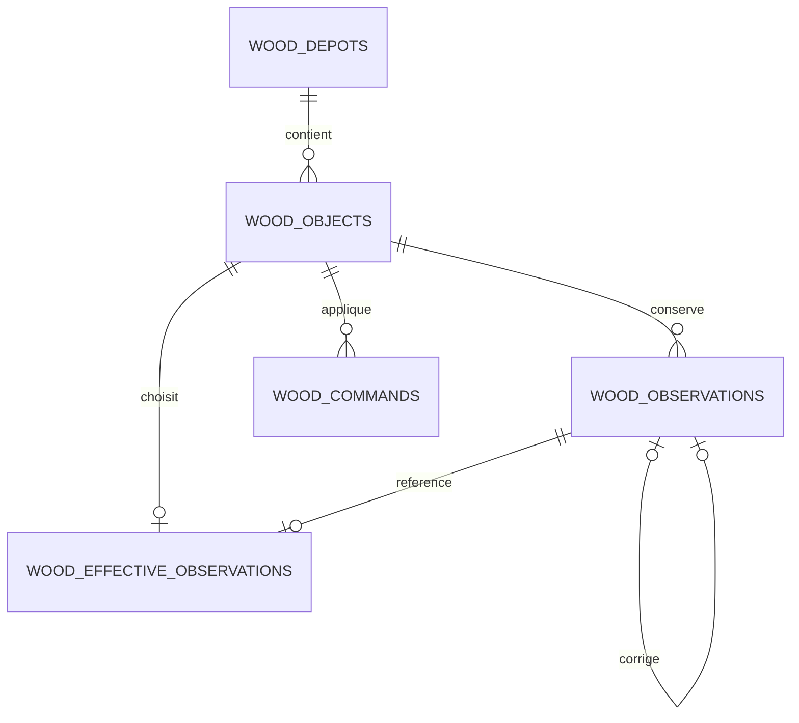

# BOIS-01 — spécification de réalisation prête à coder

Actualisation du 18 : [contrats C01 codés](CONTRATS_BOIS_C01_2026-10-18.md),
[formulaires et persistance C02/C03 vérifiés](FORMULAIRES_BOIS_C02_C03_2026-10-18.md) et
[besoins prospection/estimation/photos](PROSPECTION_ESTIMATION_PHOTOS_BOIS_2026-10-18.md).
Le codec v1 décrit les relevés dimensionnels, sans pièce photo encore raccordée ;
une extension devra être versionnée. Les sections du 14 restent le contrat historique :
la sauvegarde locale est désormais raccordée, mais le récapitulatif et les exports restent
à réaliser. La [recherche métier du 18](AMELIORATIONS_USAGES_METIERS_BOIS_2026-10-18.md)
propose des compléments d'usage ; elle ne modifie pas silencieusement le contrat codé.

## Complément produit courant — deux expériences et données TEST

Le Fondateur demande désormais des cheminements différents pour Gestion forestière et Chantiers/valorisation, le débranchement des outils inutiles, la hiérarchie et l’archivage des chantiers, puis validation visuelle avant la version TEST. Il autorise explicitement des **données simulées cohérentes**, faute de relevés disponibles. Lire le [contrat des deux parcours](DEUX_PARCOURS_HIERARCHIE_ARCHIVES_TEST_2026-10-14.md) et le [jeu synthétique](SCENARIOS_SYNTHETIQUES_DEUX_PARCOURS_2026-10-14.json), pas encore importé.

Ce complément prime sur une présentation forestière universelle ou le maintien d’entrées sans pertinence. N01 (politique/liaisons de navigation) précède la qualification des écrans C03 ; les contrats/persistance locaux C01/C02 restent préparés. S01/S02 entreprise/chantier/missions/archives sont de nouvelles tranches à réaliser et qualifier, pas des modules déclarés prêts par le seul dossier BOIS-01.

Les jeux synthétiques restent TEST, marqués jusque dans les exports, avec vrais calculs/repositories et permissions. Le dataset ne donne aucun droit et ne réaffecte pas un objet personnel à une entreprise ; le futur raccord collaboratif exige un contexte d’espace et une migration explicites. La portée LOCAL_DEVICE/PERSONAL de ce premier contrat reste celle effectivement définie ci-dessous.

| Champ | Valeur |
| --- | --- |
| Date | 14 octobre 2026 |
| État | Premier lot local spécifié pour commencer le codage ; application du lot non encore implémentée. |
| Cadre confirmé | [Quatre parcours et 22 actions métier](CONTRAT_ACTIONS_METIER_FORLOG_2026-10-14.md). |
| Socle réellement lu | Branche `work`, base `c59ba7cc…` avec WIP conservé ; Room 43, dépôts locaux, noyau géométrique `wood-reception-volume-1` / `1.0.0`. |
| Périmètre à réaliser | Objet pile/grume, observations/corrections, récapitulatif explicite, calcul géométrique provisoire ; lot d’exports réel séparé. |
| Préconditions externes du premier lot | Aucune connexion Google/GSIE/FORLOG nécessaire au parcours local. Les conventions commerciales et l’intégration client gardent leurs preuves manquantes. |
| Déroulement | [Plan C01–C08, critères R01–R20 et dépendances](PLAN_CODAGE_BOIS_2026-10-14.md). |

Les décisions métier explicites du Fondateur font foi. Les détails ci-dessous sont des **choix techniques de réalisation GeoSylva**, pas des règles démontrées du client. Cette spécification principale tranche les différences de noms/détail dans les annexes ; elle ne modifie aucune fonctionnalité par sa seule présence.

## Annexes de réalisation

| Annexe | Contenu fixé |
| --- | --- |
| [Persistance et commandes](ANNEXE_BOIS_01_PERSISTANCE_2026-10-14.md) | Modèles/champs/tailles, quatre tables/indices/FK, commandes, algorithme atomique, accès/effacement, migration et cas Room. |
| [Parcours Android](ANNEXE_BOIS_01_UX_2026-10-14.md) | Routes et écrans, formulaires/états/erreurs, textes FR/EN, Material 3, capture vs brouillon et recettes visuelles. |
| [Calcul et export](ANNEXE_BOIS_01_CALCUL_EXPORT_2026-10-14.md) | Adapter/diagnostics, unités/méthodes, sélection/totaux, snapshots, colonnes CSV, GeoJSON, PDF, fichiers et remise Android. |

## Invariants applicables au code

1. Une pile/grume est un **objet physique stable**. Numéro, GPS, méthode, mesure ou utilisateur ne fournissent pas un ID client présumé global.
2. Nouvelle mesure = observation du même objet. Correction = nouvelle version liée et motivée. Aucune observation antérieure n’est mise à jour ou remplacée.
3. Une capture ne crée **ni entrée/sortie de stock, ni transaction, ni paiement**. Un relevé pourra servir plusieurs bases commerciales propres dans les lots ultérieurs.
4. Le calcul consomme les seuls bruts de l’observation et sa méthode explicite, avec unités/positions/écorce/protocole. Pas de méthode ou coefficient fourni par défaut depuis métier/GPS/pack.
5. Valeur absente, texte invalide et zéro numérique restent distincts. Une capture partielle conserve sa provenance ; indisponibilité de calcul ne devient pas volume nul.
6. Pour un récapitulatif courant, au plus une observation choisie par objet ; aucune somme de remesures ou de versions. Série historique sans total de volume.
7. Compte, génération, droits, parents et révisions sont revérifiés au dépôt canonique ; le ViewModel, l’UUID de route et le métier n’accordent aucun accès.
8. Avant commit, refus de garde annule la transaction ; après commit, une réponse perdue ou un accès changé peut rendre le résultat **inconnu**, pas une garantie de rollback. Reprendre par ID de commande et receipt durable.
9. Archivage et perte de droits sont distincts ; historique/documents autorisés conservés. Purge physique reste une action explicite, sans résurrection par commande ancienne.
10. Exports propres à GeoSylva, captures gelées et fichiers réellement vérifiés ; aucun import, réponse ou acceptation commerciale FORLOG présumé.

## Arbitrages fermés pour commencer

| ID | Choix de réalisation |
| --- | --- |
| D01 — Portée | Hériter du dépôt : `LOCAL_DEVICE` + compte absent ou `PERSONAL` + compte réel. Pas de portée entreprise fictive, adoption automatique au login ou déplacement entre espaces. |
| D02 — Identité | `WoodObjectKind { PILE, LOG }` généré avec UUID canonique automatique ; type/dépôt/scope immuables. Libellé requis, description/numéro/origine/position facultatifs. Tag non unique globalement. |
| D03 — Temps | Date du fait déclarée facultative : instant + zone IANA + offset cohérents, ou les trois absents avec UNKNOWN visible. Date seule sans heure non transformée en minuit ; l’utilisateur précise ou garde inconnue. Date/zone/offset de saisie réels capturés au commit. |
| D04 — Bruts | Payload immuable `schemaVersion=1`, parser `wood-raw-decimal-1`. `rawText` exact ≤128 caractères, unité ≤32 ; canonique dérivé facultatif. Malformation/non-fini/absence sauvegardables avec diagnostic, dépassement structurel refusé, jamais troncature. |
| D05 — Unités | Codes reconnus exacts `m`, `cm`, `mm` ; conversion métrique décimale exacte avant Double du noyau. Formulaire affiche l’unité et permet son choix ; valeur proposée m pour longueur et cm pour diamètre, visible et modifiable. Unité inconnue conservée mais non calculable, pas d’interprétation commerciale. |
| D06 — Formes/méthodes | Pile : enveloppe rectangulaire seulement si explicitement choisie ; référence de protocole requise pour calcul, pas pour enregistrer. Grume : méthode et convention d’écorce choisies, aucun défaut Huber/sur écorce. Positions début/mi-longueur/fin du segment, pas DBH. |
| D07 — Autres sections | Version 1 garde le refus du noyau pour les sections non prévues par la méthode : `UNUSED_SECTION_PRESENT`. Le formulaire conserve et montre les bruts hors méthode après changement ; permet de sauvegarder sans calcul ou de choisir/corriger explicitement. Pas de suppression silencieuse pour faire réussir le calcul. |
| D08 — Création | UX initiale : identité seule enregistrée, puis action Relever. API permet objet + première observation demandée + sélection + receipt dans une transaction unique. Aucun objet partiellement créé si cette commande groupée échoue. |
| D09 — Récapitulatif | Nouvelle observation : case visible `makeEffective`, activée par défaut seulement sans sélection existante ; choix sauvegardé atomiquement. Dernier relevé affiché ≠ relevé effectif. |
| D10 — Correction | Corriger uniquement la tête exacte d’une racine, avec révision et motif. Commande de correction **sans flag de sélection** ; après enregistrement, action séparée pour choisir la nouvelle tête. Une effective corrigée reste pointée mais SUPERSEDED et exclue du total courant avec motif/couverture. Historique exact exportable, archives anciennes inchangées. |
| D11 — Brouillons | En mémoire, isolés par compte/génération/epoch ; rotation même session possible. Capture persistée survit à fermeture ; brouillon non enregistré non garanti après mort de processus. Ne pas restaurer un payload sensible sous un autre compte. |
| D12 — Fichiers | SAF pour la remise initiale ; aucune ouverture générale de FileProvider. Archive privée sous `filesDir/wood_exports`, staging distinct, fichier/manifeste vérifiés avant promotion ; purge et garde epoch raccordées. |

Ces choix sont révisables par une future décision produit, mais un lot de code ne peut adopter une variante contradictoire dans un seul des trois modules. Les changements doivent mettre à jour le contrat avant le travail dépendant.

## Modèle et noms canoniques

Le schéma actuel `wood_depots` est conservé. Ajouter seulement :

| Table | Rôle |
| --- | --- |
| `wood_objects` | Identité stable, header versionné/hashé, owner/dépôt, révision d’agrégat, auteur/dates et archivage. |
| `wood_observations` | Bruts immuables, racine/révision/correction exacte et motif, payload/hash, auteur et temps de saisie. |
| `wood_effective_observations` | Zéro ou une sélection par objet, observation exacte, date/auteur/opération de sélection ; projection mutable avec changement conservé dans les receipts. |
| `wood_commands` | Commande complète et receipt appliqué, octets/hashes/version, owner/parents/type ; registre de réussites locales, pas une file réseau. |

FK et indices sont détaillés dans l’annexe persistance. Pas de cascade métier ou de FK circulaire commande/sélection. Unicité de la correction directe et de `(rootObservationId, observationRevision)` ; une remesure indépendante crée une autre racine. Concurrence locale résolue par CAS de l’agrégat ; la branche perdante conserve sa saisie, sans écraser les données.

**Noms de champs mesures de payload v1** :

| Formulaire | Champs canoniques | Unité normalisée vers le noyau |
| --- | --- | --- |
| Pile | `pileLength`, `pileDepth`, `meanPileHeight`, `pieceLength` ; forme/protocole explicites | m ; `pieceLength` ne remplace pas `pileDepth`. |
| Grume | `segmentLength`, `diameterAtStart`, `diameterAtMiddle`, `diameterAtEnd` | Longueur m ; diamètres cm aux positions exactes. |

Les noms abrégés `length/depth/meanHeight`, `diameterButt/Middle/Top` dans l’annexe calcul désignent ces mêmes champs et ne sont pas un second schéma. Les descriptions/positions historiques sont capturées dans l’observation ; un nouveau header d’objet ne les remplace pas lors de la relecture.

Déclaration d’origine sans référence : texte clair permis, jamais un ID lié. Toute référence locale forêt/parcelle/dossier structurée exige un lecteur canonique et une liaison vérifiée ; si le sélecteur sûr n’est pas raccordé dans le lot, garder seulement la déclaration textuelle. Aucun objet forestier fictif pour rendre un formulaire enregistrable.

## Commandes et frontière de transaction

API de lecture : accès opaque capturé, état de liste active/historique et lecture exacte d’objet/observation/receipt. Toutes les commandes passent par `WoodObjectRepository`, avec `access` distinct et non sérialisé :

| Commande | Intention et précondition |
| --- | --- |
| `CreateWoodObject` | Identité seule ou première observation atomique explicitement fournie, IDs nouveaux, dépôt vivant/autorisé. |
| `UpdateWoodObjectHeader` | Header du même objet, révision attendue ; type, dépôt et owner intouchables. |
| `AddWoodObservation` | Nouvelle racine du même objet, payload et UUID nouveaux, option `makeEffective` explicite. |
| `CorrectWoodObservation` | Tête/source/révisions exactes et motif ; aucun déplacement d’effective. |
| `SelectEffectiveObservation` | Observation tête non corrigée du même objet et scope, CAS révision d’agrégat. |
| `ArchiveWoodObject` | Retrait de liste active, observations/receipts conservés ; aucun enlèvement ni zéro de stock. |

Créer les IDs avant la tentative ; figer le graphe complet et les octets de commande avant hash/attente. Empreinte inclut type, owner/auteur, parents, IDs/révisions/intention et payload, exclut clock de retry et tokens. Rejeu même opération et contenu sous scope autorisé = receipt d’origine sans nouveau CAS/effet. Contenu différent sous même ID = conflit.

Ordre de mutation : **garde opaque actuelle → verrou partagé bois/purge → transaction Room → receipt existant ou contrôles/parents/CAS → inserts/sélection/receipt → contrôles avant commit → contrôle de remise du résultat**. Lire la réussite de la commande après interruption sous accès autorisé ; `CancellationException` n’est pas avalée. Ne pas reprendre avec nouvel ID pour masquer un résultat inconnu.

Ajouter le gate `WoodDataAccessGate` partagé aux dépôts, objets, effacement et future archive : epoch monotone, captures refusées pendant purge, ordre verrou avant transaction. Une écriture déjà terminée avant purge est effacée ; une commande ancienne en attente refuse après changement d’epoch. Les autres modules ne sont pas annoncés qualifiés par ce gate bois.

Le flag et le verrou de purge restent actifs pendant tout `execute()`, y compris le nettoyage des répertoires privés après la transaction Room. Rouvrir les captures uniquement dans le `finally` extérieur, après la fin ou l’échec explicite de l’effacement de fichiers ; une promotion d’archive ne peut s’intercaler dans cette phase.

Purge : commandes → sélections → observations → objets → dépôts, dans la transaction d’effacement existante, puis fichiers bois. L’opération courante de suppression de toutes données locales reste celle de l’application ; pas de purge au logout ou destruction d’un espace entreprise simulé. Pas de destructive migration.

## Migration, injection et navigation

Migration **43 → 44 additive**, quatre tables et indices/FK concordants aux annotations. Générer `44.json` par KSP ; `43.json` et anciennes données conservés, tables nouvelles vides. Vérifier aussi la chaîne 42 → 43 → 44 et SQLCipher réel sur données TEST. Si la base de travail a avancé, réviser le numéro avant de coder.

`ForestryCounterApplication` construit une seule instance du gate et des repositories ; branche `woodObjectDao`, les nouvelles entités/migration et l’effacement. Injection manuelle existante, aucune dépendance Hilt ajoutée.

Entrée : **Explorer → Dépôts → fiche réelle → Bois de ce dépôt**. Routes `wood/depots/{depotId}/objects`, fiche avec `{objectId}`, lecture exacte avec `{observationId}`. Routes seulement UUID, pas de données/compte dans l’URL ; filtrage d’accès canonique à l’ouverture. Barre principale conservée.

Six vues : liste, identité progressive, nouveau relevé, fiche/récapitulatif, historique/correction, archives. `WoodObjectsViewModel` et `WoodObjectViewModel` séparent les formulaires ; ressources `values/wood_objects.xml` et `values-en/wood_objects.xml`, tokens Material 3 existants et commandes utilisables clavier/texte 200 %. Métier adapte textes/ordre d’information, jamais droits.

## Raccord de calcul fermé

`WoodRawDecimalParser` puis `WoodObservationVolumeAdapter` purs. Parser : décimal ASCII simple signé, point ou virgule, pas de milliers/expression ; blancs périphériques ignorés au parsing seulement, brut exact conservé. Normalisation métrique exacte et conversion unique aux Double du noyau ; pas d’acceptation d’un cache canonique fourni par l’UI.

`canonicalDecimal` est le nombre décimal parsé dans **l’unité originale déclarée**, pas déjà normalisé. Les entrées normalisées m/cm du calcul sont une projection distincte ; cela évite une seconde conversion. Le diagnostic brut distingue syntaxe/absence/unité inconnue ; positivité ou zéro admissible dépendent ensuite du champ et de la méthode dans l’évaluation de calcul. La grammaire accepte signe facultatif, chiffres ASCII avec une seule partie décimale et au moins un chiffre de chaque côté du séparateur lorsqu’il est présent ; milliers et notation exponentielle non pris en charge dans v1, bruts conservés comme non exploitables.

Pour des entrées représentables, appel au noyau existant. Résultat typé `Provisional` ou `Unavailable(diagnostics)`, volume absent `null`. Méthode/version/entrées/écorce/protocole et limites joints au résultat. Ne pas extraire les codes d’erreurs depuis les messages français d’exception ; contrôles typés puis refus numérique restant explicite. Zéros conditionnels de Smalian/Newton respectés, pas de règle générale interdisant tout diamètre nul.

Pile sans forme explicitement choisie : `MISSING_SHAPE` ; forme non supportée : `UNSUPPORTED_SHAPE`. Un décimal normalisé non nul converti en Double zéro donne `NUMERIC_UNDERFLOW` avant le noyau, sans profiter d’un zéro permis à certaines sections. `sourcePayloadSha256` est le `payloadSha256` exact de l’observation immuable ; identité/révision/auteur restent ancrés séparément dans le snapshot complet, pas dans un hash d’objet interprété comme mesure.

`CURRENT_STATE` : effective enregistrée non corrigée, au plus une par objet ; grouper par nature, écorce/protocole exacts et versions compatibles. Aucun résultat calculable = total absent, couverture visible ; exclusions/manquants présents. `OBSERVATION_SERIES` : toutes les versions choisies avec filiation/avertissements, sans total de volume.

Le résultat dérivé courant est en mémoire : **pas de table calcul nécessaire pour BOIS-01**. L’export archive les entrées et résultats/version du moteur, puis vérifie ces octets ; un moteur futur ne remplace pas un ancien document. Aucune précision de mesure, qualité forestière, quantité payable ou convention commerciale déduite du résultat géométrique.

## Export prêt à réaliser après le socle

L’annexe fixe `wood-observation-export-1`, `CURRENT_STATE`/`OBSERVATION_SERIES`, colonnes CSV et propriétés GeoJSON. Réaliser un snapshot unique autorisé de dépôt/objet/observation/versions/sélection, libellés réellement capturés, bruts et méthodes/résultats/limites. Archiver `inputs.json` UTF-8 et son SHA, puis fichiers et manifeste avec tailles/empreintes ; pas de hash du manifeste dans lui-même.

- CSV UTF-8/BOM, virgule/CRLF et échappement de guillemets ; colonnes lisibles + `record_json` exact. Préfixe tableur de textes risqués réversible et liste des colonnes transformées ; brut JSON jamais modifié. Vérifier indépendamment colonnes et entrée, pas seulement relire le JSON inclus.
- GeoJSON RFC 7946, coordonnées `[longitude, latitude]`, `geometry: null` pour non-localisés ; objet présent, absence/source explicites. Aucun point de dépôt substitué silencieusement.
- PDF A4 de relevé : résumé/couverture des calculs, tableaux paginés, méthodes/bruts/limites, positions réellement disponibles. Sans fond géographique licencié disponible, représentation de positions relative clairement nommée ; pas de carte imaginaire. Aucun montant ou facture produit par le calcul de volume.
- Archive privée sous `wood_exports`, staging temporaire puis promotion sous gate après revalidation ; les lectures d’archive vérifient owner/droits et hashes, pas le seul nom de fichier. Ancien artefact non écrasé.
- SAF : capture avant picker, garde d’origine revérifiée au retour et à la copie, fichier final rouvert/hash comparé. `VERIFIED`, écrit non vérifiable, annulé, échec, accès changé et sortie partielle restent des états différents. Aucun rappel d’octets externes déjà remis promis.

Les captures/rendus doivent observer la même epoch que l’effacement ; la promotion d’archive ne peut recréer un fichier après purge avec une ancienne capture. La recette couvre stockage privé, destination et corruption. Pas de `ACTION_SEND`/élargissement FileProvider dans le premier raccord ; l’annexe décrit les conditions si ajouté ultérieurement.

## Feu vert de préparation et limites

Les choix D01–D12, schéma/API, parcours, adapter et formats d’export sont fixés pour **C01–C08**. Aucun arbitrage client absent n’est nécessaire pour commencer C01/C02 et progresser sur ce parcours local. Les lots A01–A22 plus larges ont leurs rôles/actions/contrôles spécifiés, mais les mouvements, règles commerciales, missions d’entreprise et connecteur exigent les préconditions du plan avant activation.

Le 14 octobre, **54 tests existants / quatre suites** passent sur ce socle via Gradle 8.2/JDK 17.0.20.1 en mode hors ligne ; ils prouvent la disponibilité du workflow et les anciens noyaux, **pas la réalisation future**. [Preuve](../../.onboarding/forlog-ready-to-code-2026-10-14/EXISTING_TESTS_PROOF.json). Pas de nouvel APK, migration ou connexion Google/FORLOG par cette spécification. Le prochain travail de code est C01, puis C02 et leurs recettes réelles.
