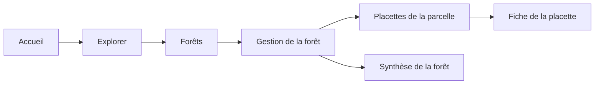
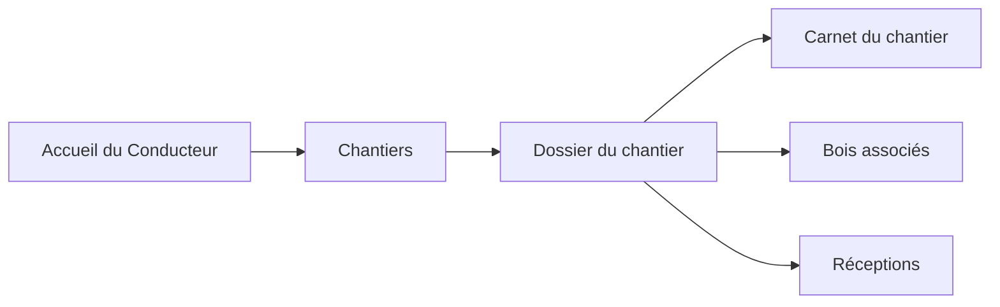

# Parcours Android de GeoSylva

Référence de navigation de la version de construction 3.0.0, au commit
`3c57225a5331c32af856253a7e8372a03e6e8272`. Le premier lancement hors ligne
jusqu’à l’accueil Technicien a été observé sur Android 16 en émulateur.

## Premier lancement

Le choix est conservé dans les préférences du téléphone. Une installation déjà
configurée ouvre directement l’accueil. Modifier le métier reste possible dans
Réglages. Le choix détermine les entrées visibles du parcours. Les autorisations
sur les données sont vérifiées séparément.
[Démarrage](../../app/src/main/java/com/forestry/counter/presentation/navigation/ForestryNavigation.kt) · [Réglages](../../app/src/main/java/com/forestry/counter/presentation/navigation/SettingsNavGraph.kt)

## Parcours Technicien

La gestion de la forêt donne aussi accès à la carte et aux actions du dossier.
Une méthode de cubage doit être qualifiée pour produire un résultat utilisable.
[Navigation des forêts et des placettes](../../app/src/main/java/com/forestry/counter/presentation/navigation/ForestryFlowNavGraph.kt) · [Accès depuis la forêt](../../app/src/main/java/com/forestry/counter/presentation/navigation/ForestDetailNavGraph.kt)

## Parcours Conducteur de travaux

Le dossier conserve le contexte du chantier sélectionné lorsqu’il ouvre le
carnet ou les réceptions. La fiche du bois retenue reste à raccorder.
[Dossier du chantier](../../app/src/main/java/com/forestry/counter/presentation/screens/field/WorksitesScreen.kt) · [Suivi des raccordements](SUIVI_INTEGRATION_MAQUETTES.md)

Le [catalogue des maquettes](../maquettes/README.md) documente les décisions
visuelles. Le [schéma de conception historique](../UI_NAVIGATION_MAP.md)
documente les parcours envisagés dans la spécification 3.0 v0.8.0.
